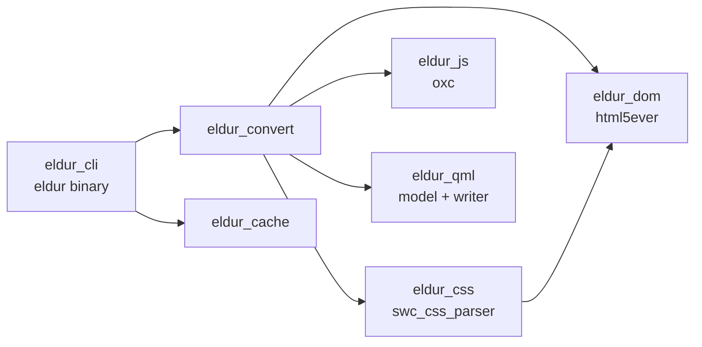

# Architecture

Eldur turns a static web page (HTML5, CSS, classic JavaScript) into a
QML application for Qt 6.11 that looks and behaves like the page did in a
browser at a given viewport, and stays readable and editable QML.

The project was formerly html-2-qml.

## Goals

1. **Faithful.** At the conversion viewport, the QML window should look like
   Chromium's rendering of the page (measured, see *Quality*).
2. **Idiomatic.** Output uses QtQuick Layouts, anchors and bindings the way a
   QML developer would write them, so it stays responsive and editable. No
   absolute pixel dumps, no WebEngine, no "one big RichText".
3. **Honest.** What cannot be converted is reported as a diagnostic, never
   silently dropped.
4. **Fast and incremental.** Converting an unchanged page is a cache hit.

## Crates

| Crate | Does | Built on |
|---|---|---|
| `eldur_dom` | WHATWG parsing into an arena DOM (`NodeId`) | html5ever 0.40 (own `TreeSink`) |
| `eldur_css` | Style sheets, selector matching, cascade, inheritance, computed values, `:hover`-style state variants | swc_css_parser 26, csscolorparser |
| `eldur_js` | Script analysis and rewrite into `page.js`; the `eldur_runtime.js` shim | oxc 0.144 (same as ljos-ui) |
| `eldur_qml` | QML document model and formatter | — |
| `eldur_convert` | Box tree and the HTML/CSS → QML mapping | the above |
| `eldur_cache` | Content-addressed build cache (BLAKE3) | blake3 (ideas from ljos-ui) |
| `eldur_cli` | `eldur convert/watch/check` | clap, notify |

Why these parsers: html5ever is the spec-complete HTML parser (MIT/Apache).
swc_css_parser implements CSS Syntax 3 error recovery (a bad declaration
drops that declaration, not the sheet) and gives a typed selector AST
(Apache-2.0); raffia was tried and fails whole sheets. Servo's `selectors`,
`cssparser` and `stylo`, and `lightningcss`, are MPL-2.0 and are not used.
oxc is what ljos-ui already uses.

## Pipeline

1. **Parse** the HTML (`eldur_dom`).
2. **Style**: collect `<style>`, `<link rel=stylesheet>`, `@import`; run the
   cascade with the UA sheet; compute values (`eldur_css::compute_styles`).
   Media queries are evaluated against `Options::viewport`.
3. **Analyse scripts** (`eldur_js::analyze`): which elements scripts query,
   write and listen to.
4. **Box tree** (`eldur_convert::boxes`): one box per rendered element;
   `display: contents` boxes dissolve; inline runs are gathered into
   *inline formatting contexts*; mixed block/inline children get anonymous
   block boxes; whitespace is collapsed per `white-space`; `::before` and
   `::after` become boxes; list markers are generated.
5. **Emit QML** (`eldur_convert::emit`): every box chooses a QML form (below).
6. **Rewrite scripts** (`eldur_js::rewrite`) with the ids chosen in step 5.
7. **Print** `Main.qml`, `page.js`, `eldur_runtime.js`, `assets/`.

## Mapping decisions

These are the defaults every emitter follows; `docs/spec/*.md` has the
per-property and per-element detail.

**Window.** The root is an `ApplicationWindow` sized to the viewport, titled
from `<title>`, coloured with the canvas background (the root element's
background, or body's when the root has none, CSS Backgrounds 3 §2.11.2). A
`Flickable` with `ScrollBar.vertical` fills it; the body box is its content,
`width: flickable.width`.

**Block flow → `ColumnLayout`.** A block container lays out its block
children in a `ColumnLayout` with `spacing: 0`; each child gets
`Layout.fillWidth: true` unless it has a definite width, and its margins as
`Layout.topMargin`/`bottomMargin`/`leftMargin`/`rightMargin`. Adjacent
vertical margins are collapsed at conversion time (both lengths in px:
`max`; otherwise the larger is kept and a diagnostic noted). `margin: 0
auto` with a width centres with `Layout.alignment: Qt.AlignHCenter`.

**Box decoration → wrapper.** A box with a background, border, radius,
padding, shadow, `overflow` other than visible, or that is the containing
block of absolutely positioned descendants becomes a `Rectangle` (or `Item`
when nothing is painted) whose content layout is anchored inside with
`anchors.fill: parent` and margins = padding + border width, and whose
`implicitWidth`/`implicitHeight` are the content's implicit size plus those
margins. Otherwise the box is just its layout (no extra `Item`).

**Inline formatting context → one `Text`.** A run of inline content becomes
one `Text { textFormat: Text.StyledText; wrapMode: Text.Wrap }` with
`Layout.fillWidth: true`, using StyledText tags for `b/strong/i/em/u/s/a/
br/sub/sup/code` and `` for colour changes. Links get
`onLinkActivated: (link) => Qt.openUrlExternally(link)`. The run is split
into separate items only when an inline box needs something StyledText cannot
draw: background, border, padding, a script or `:hover` target. The block's font, colour, line
height, alignment and letter spacing go on the `Text`. A run holding
an atomic box (a replaced element, a control, `inline-block`) is laid out by
`EldurLines.qml`, written beside `Main.qml`: the text between boxes stays whole
`Text` runs and the boxes sit on CSS line boxes (`docs/spec/layout.md` §2).

**Flexbox → `RowLayout`/`ColumnLayout`, `Flow` for wrapping.** `gap` →
`spacing`; `flex-grow` > 0 → `Layout.fillWidth/fillHeight` with
`Layout.horizontalStretchFactor`/`verticalStretchFactor` for ratios;
`justify-content` → leading/trailing/between spacer `Item`s with
`Layout.fill*`; `align-items`/`align-self` → `Layout.alignment`;
`*-reverse` → children emitted in reverse; `order` → children sorted.

**Grid → `GridLayout`.** `columns` from the explicit track count; `fr` tracks
via fill + stretch factors; explicit placement via `Layout.row/column/
rowSpan/columnSpan`; `grid-template-areas` resolved to placements.

**Tables → `GridLayout`** with `colspan`/`rowspan`; `border-collapse`
approximated.

**Positioning.** `relative` → `transform: Translate`; `absolute` → a child of
the containing block's wrapper (outside its layout), or with no positioned or
transformed ancestor of the initial containing block's item in the Flickable,
placed with `x`/`y`/`width` bindings or anchors from `top/right/bottom/left`;
`fixed` → child of the window's content item, outside the Flickable, unless a
transformed ancestor holds it; `sticky` →
treated as relative (diagnostic). `z-index` → `z`.

**Replaced elements.** `img` → `Image` (`fillMode` from `object-fit`,
intrinsic size read from the file header, `asynchronous: true`);
`video/audio` → diagnostic placeholder; inline `svg` → saved as
`assets/*.svg` and shown with `Image`; `canvas` → `Canvas` with a
diagnostic.

**Forms → QtQuick.Controls.Basic.** `input[type=text…]` → `TextField`,
`textarea` → `TextArea`, checkbox/radio → `CheckBox`/`RadioButton`, `select`
→ `ComboBox`, range → `Slider`, number → `SpinBox`, `button`/submit →
`Button`, `progress` → `ProgressBar`. The page's CSS restyles them through
`background:`/`contentItem:` only where it sets visible properties.

**Units.** CSS px = QML logical px. `%` of the containing block →
`parent.width * f` bindings (or `Layout.preferredWidth` with fill); `vw/vh`
→ `window.width`/`window.height` bindings; `em/rem` resolved to px.
Colours → `"#rrggbb"`/`"#aarrggbb"` (QML puts alpha first).

**Dynamic pseudo-classes → bindings.** For each `StateVariant`
(`.btn:hover`), the condition element gets a `HoverHandler`/`TapHandler`
(or uses the control's own `hovered`/`pressed`/`activeFocus`/`checked`),
and each changed property becomes a conditional binding
(`color: btnHover.hovered ? "#0056b3" : "#007bff"`).

**Transitions → `Behavior`**, `@keyframes` → `SequentialAnimation` of
`PropertyAnimation`s with `loops`.

**Scripts.** `page.js` holds every classic script; statically resolvable DOM
access becomes direct id access; event handlers become QML signal
handlers that call `Page.<fn>(Eldur.event(...))`; the rest goes through
`eldur_runtime.js` (`docs/spec/dom-api.md`).

**Ids.** HTML `id`s become sanitized QML ids (`main-nav` → `mainNav`, made
unique); elements scripts or state variants refer to get generated ids
(`div3`); everything else has none.

## Build cache

Borrowed from ljos-ui:

- *Compile cache*: `.cargo/config.toml` (machine-local) sends rustc through
  the shared sccache at `/run/media/…/sccache`, incremental off, 12 jobs;
  `target/` and `TMPDIR` live on the big disk. Worker checkouts share the
  sccache and use their own target directories.
- *Conversion cache* (`eldur_cache`): BLAKE3 hashes of every input the
  conversion read, keyed by entry file + converter version + options;
  outputs stored content-addressed; size+mtime as a fast path before
  hashing. `eldur watch` uses `Fingerprints` so touching or re-saving a
  file without changes does nothing.

## Quality

1. Unit tests per crate; `insta` snapshots for the corpus in
   `tests/corpus/<case>/index.html` → `Main.qml`.
2. Every snapshot passes `qmllint` and loads in `qml6` off-screen with no
   warnings (`mise run qml:check`).
3. Visual parity (`tools/visual/`): Chromium (Playwright) screenshots the
   page, `qml6` off-screen screenshots the QML at the same size; a
   perceptual diff score per case is tracked so regressions show.
4. Model review: independent reviewers (Opus/Sonnet) read diffs and
   screenshot pairs; Haiku does bulk spec work.
