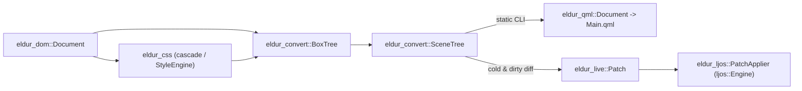

# Design: Live DOM & HTML Renderer Mode for Ljós (`HtmlView`)

Status: Proposed (rev 2) · Branch: `w/live-design`

This document specifies how Eldur supports a **live, mutable HTML renderer** inside **Ljós** (`~/dev/ljos-ui`) alongside static QML generation (**one mapping, two back ends**). All existing `src/lib.rs` contracts remain strictly add-only.

**Current repo baseline:** `eldur_convert` (`crates/eldur_convert/src/pipeline.rs`), `eldur_css::cascade`, and `eldur_css::selectors` are `unimplemented!` stubs today, and `tests/corpus/*` contains `index.html` inputs without expected QML snapshots yet. Therefore, `SceneTree` (§1.2) and `eldur_css`'s shared selector matcher (§3.2) are designed as **day-one internal targets** agreed across `eldur_css`, `eldur_convert`, and `eldur_live`, rather than retrofits onto existing implementations.

---

## 1. One Pipeline, Two Back Ends

### 1.1 Back-End Choice: Direct `ljos::Engine` API (`PatchApplier`), Not QML Text or `ljos_ir`

1. **Why not QML text:** Shipped Ljós apps link no QML parser today (`~/dev/ljos-ui/AGENTS.md` Rule 5; `~/dev/ljos-ui/docs/ARCHITECTURE.md` §4 line 246 notes a shipped-app compiler feature for malleable Goal 9 *"is still to come"*). `set_qml_text_compiler` (`~/dev/ljos-ui/crates/ljos_engine/src/incubator/dynamic.rs:183`) is installed only under `dev-qml` (`ARCHITECTURE.md` §6.3 line 441). Printing QML text only to re-parse it at runtime is neither available in shipped apps today nor needed.
2. **Why `ljos_ir::CompiledFile` was evaluated and rejected for live mode:** Although `CompiledFile` (`~/dev/ljos-ui/crates/ljos_ir/src/lib.rs:67`) has public fields and `note_facts()` (`lib.rs:135`), four facts in `ljos-ui` rule it out for `HtmlView`:
   - *Still emits JS source & unstable VM internals:* Every `ljos_ir::Binding` requires a `js_fn` pointing into JS source text in `JsModule.source` (`ljos_ir/src/lib.rs:682–721`), while `Tier1` bytecode (`IR_VERSION = 14`, `lib.rs:32`) is optional and generated from the tier-2 JS function (`ARCHITECTURE.md` §5.4 line 295).
   - *Cannot load an in-memory file without clobbering the host app:* `Engine::create_from_url_in` loads through the engine's single `ComponentSource` (`~/dev/ljos-ui/crates/ljos_engine/src/incubator.rs:403–410`), and `Engine::set_component_source` clears all loaded files and resets singletons (`~/dev/ljos-ui/crates/ljos_engine/src/loader.rs:739–746`).
   - *Not a stable facade contract:* `ljos` only depends on `ljos_ir` behind `dev-qml` (`~/dev/ljos-ui/crates/ljos/Cargo.toml:57,101`), and items outside the `ljos` facade are *"internal in spirit"* and may change without notice (`~/dev/ljos-ui/crates/ljos/src/lib.rs:11–14`).
   - *`ReloadPatch` is dev-only:* While `Engine::reload` tries `reload_in_place` before rebuilding roots (`~/dev/ljos-ui/crates/ljos_engine/src/incubator/reload.rs:724`), it requires dev reload tracking (`ReloadError::NotTracking`, `reload.rs:705`) and must run between frames, outside any batch (`reload.rs:696`).
3. **Decision — One cold-load & incremental path in live mode:**
   - **`eldur_convert`** builds `BoxTree → SceneTree` as its single mapping output.
   - **Static back end** (`eldur_convert::lower_qml`): `SceneTree` → `eldur_qml::Document` → `.qml` text (plus `page.js` / `eldur_runtime.js`). Static AOT Ljós packs compile that `.qml` output at build time via `ljos::build::compile_dir_with_types` (`~/dev/ljos-ui/crates/ljos/src/build.rs:159`).
   - **Live back end** (`eldur_live` + `eldur_ljos::PatchApplier`): **both** cold loads (diff against an empty `SceneTree`) and DOM mutations emit `Vec<Patch>` applied directly to `ljos::Engine` inside `Engine::batch` (`~/dev/ljos-ui/crates/ljos_engine/src/engine.rs:3094`).
4. **Known divergences between static and live outputs:** Both share CSS cascade, box construction, and `SceneTree` lowering, but differ where execution models differ: (a) static mode rewrites JS against `eldur_runtime.js` (`crates/eldur_js/src/lib.rs:4–26`), while live mode runs un-rewritten DOM calls against the Rust DOM; (b) `InteractiveSet` comes from `eldur_js::Analysis` statically vs live listener/focus state dynamically; (c) live mode keeps wrapper/IFC promotions sticky across toggles (§3.3).



### 1.2 Back-End-Neutral `SceneTree` in `eldur_convert`

Every row of `docs/spec/css-properties.md`, `docs/spec/layout.md`, and `docs/spec/html-elements.md` must lower through `SceneTree`. Anonymous inline runs and flex spacers anchor their `ObjectRole` to a DOM child `NodeId` rather than shifting integer ordinals, so inserting a sibling never re-keys unrelated runs or spacers.

```rust
// Additions to crates/eldur_convert/src/lib.rs (day-one internal target of eldur_convert)

/// Which DOM elements cannot merge into a parent block's StyledText `Text`.
pub trait InteractiveSet {
    fn needs_own_item(&self, node: eldur_dom::NodeId) -> bool;
}

#[derive(Debug, Clone, Copy, PartialEq, Eq, PartialOrd, Ord, Hash)]
pub struct SceneNodeId(pub u32);

#[derive(Debug, Clone, Copy, PartialEq, Eq, PartialOrd, Ord, Hash)]
pub struct LiveObjectKey {
    pub node: eldur_dom::NodeId,
    pub role: ObjectRole,
}

#[derive(Debug, Clone, Copy, PartialEq, Eq, PartialOrd, Ord, Hash)]
pub enum ObjectRole {
    Root, Flickable, ScrollBar, Wrapper, Layout, Control, Replaced,
    Marker, Before, After, HoverSensor, TapSensor,
    /// Anchored to the first DOM child in the run so sibling insertions do not shift keys.
    InlineRun { first_child: eldur_dom::NodeId },
    /// `None` = leading justify-content spacer; `Some(n)` = spacer right after flex item `n`.
    SpacerAfter(Option<eldur_dom::NodeId>),
    /// Box-owned sub-objects: Gradient, GradientStop, Translate, ShapePath, Animation, FontLoader, TextMetrics.
    Aux(u16),
}

#[derive(Debug, Clone, Copy, PartialEq, Eq, Hash)]
pub struct QmlTypeRef { pub module: &'static str, pub name: &'static str }

#[derive(Debug, Clone, PartialEq, Eq, Hash)]
pub enum PropTarget {
    Own(&'static str),
    Group { group: &'static str, prop: &'static str },
    Attached { ty: QmlTypeRef, prop: &'static str },
}

#[derive(Debug, Clone, PartialEq)]
pub enum LiteralValue {
    Bool(bool), Number(f64), String(String), Color(eldur_qml::Color),
    Enum { ty: QmlTypeRef, scope: Option<&'static str>, key: &'static str, value: Option<i64> },
    List(Vec<LiteralValue>),
}

#[derive(Debug, Clone, Copy, PartialEq, Eq)]
pub enum UnaryOp { Neg, Not }
#[derive(Debug, Clone, Copy, PartialEq, Eq)]
pub enum BinaryOp { Add, Sub, Mul, Div, Eq, Ne, Lt, Le, Gt, Ge, And, Or }
#[derive(Debug, Clone, Copy, PartialEq, Eq)]
pub enum MathFn { Min, Max, Floor, Ceil, Round, Abs }

#[derive(Debug, Clone, PartialEq, Eq, Hash)]
pub enum ReadTarget {
    /// Reads a property or declared slot on a keyed object (`parent.width`, `flick.contentY`,
    /// `hh.hovered`, `cardsRepeater.count`, `cards.fitCols`, `loader.name`, attached properties).
    ObjectProp { key: LiveObjectKey, prop: PropTarget },
    ViewportWidth,  // `Window.width` / `root.width` (viewport root width in `HtmlView`)
    ViewportHeight, // `Window.height` / `root.height` (viewport root height in `HtmlView`)
    PrefersDark,    // `Qt.styleHints.colorScheme === Qt.Dark` (`ljos::color_scheme` in live mode)
}

/// Typed expression AST covering all CSS/layout bindings (`calc()`, `min/max/clamp`, `%`,
/// `vw/vh/vmin/vmax`, `sticky`, `repeat(auto-fill, ...)`, `@media`, `:hover` variants).
/// Prints to QML JS text AND evaluates directly in Rust inside `Engine::bind`.
#[derive(Debug, Clone, PartialEq)]
pub enum BindingExpr {
    Literal(LiteralValue),
    Read(ReadTarget),
    Unary { op: UnaryOp, expr: Box<BindingExpr> },
    Binary { op: BinaryOp, lhs: Box<BindingExpr>, rhs: Box<BindingExpr> },
    Math { fun: MathFn, args: Vec<BindingExpr> },
    Cond { cond: Box<BindingExpr>, then_expr: Box<BindingExpr>, else_expr: Box<BindingExpr> },
    Vector2d { x: Box<BindingExpr>, y: Box<BindingExpr> },
}

#[derive(Debug, Clone, PartialEq)]
pub struct PropDecl { pub name: String, pub ty: &'static str, pub readonly: bool, pub value: Option<BindingExpr> }

#[derive(Debug, Clone, PartialEq)]
pub struct StateDef {
    pub name: String,
    pub when: BindingExpr,
    pub changes: Vec<(LiveObjectKey, PropTarget, BindingExpr)>, // lowers to State/PropertyChanges or push_override
}

#[derive(Debug, Clone, PartialEq, Eq)]
pub enum HandlerAction {
    OpenOrEmitLink, // static: `Qt.openUrlExternally(link)`; live: DOM click -> `HtmlView.linkActivated`
    DomEvent { node: eldur_dom::NodeId, event: &'static str },
    StaticCall { function: String, event: String, target_qml_id: String },
}

#[derive(Debug, Clone, PartialEq, Eq)]
pub struct HandlerDef { pub signal: &'static str, pub params: &'static [&'static str], pub action: HandlerAction }

#[derive(Debug, Clone, PartialEq)]
pub struct RepeaterDef { pub qml_id: Option<String>, pub model: BindingExpr, pub delegate: SceneNodeId }

#[derive(Debug, Clone, PartialEq)]
pub struct SceneObject {
    pub key: LiveObjectKey,
    pub ty: QmlTypeRef,
    pub qml_id: Option<String>,
    pub comment: Option<String>,
    pub prop_decls: Vec<PropDecl>,
    pub literals: Vec<(PropTarget, LiteralValue)>,
    pub bindings: Vec<(PropTarget, BindingExpr)>,
    pub inline_objects: Vec<(PropTarget, SceneNodeId, bool)>, // `(target, obj, is_list)`
    pub behaviors: Vec<(PropTarget, SceneNodeId)>,
    pub states: Vec<StateDef>,
    pub handlers: Vec<HandlerDef>,
    pub repeater: Option<RepeaterDef>,
    pub children: Vec<SceneNodeId>,
}

#[derive(Debug, Clone, Default, PartialEq)]
pub struct SceneTree {
    pub objects: Vec<SceneObject>,
    pub root: Option<SceneNodeId>,
}
```

---

## 2. Mutable DOM (`eldur_dom` Additions)

### 2.1 Stable `NodeId`s, Side-Table Liveness, and Quarantined Free List

`eldur_dom` (`crates/eldur_dom/src/lib.rs`) exposes `pub struct NodeId(u32)` and exhaustive `pub enum NodeData`, while `eldur_css::StyleMap` indexes `Vec<Option<ElementStyle>>` by `id.index()` (`crates/eldur_css/src/lib.rs:189,200`).

1. **`NodeData` is unchanged.** `Document` stores slot state in private side vectors `generations: Vec<u32>` and `alive: Vec<bool>`.
2. **Connected vs detached vs reclaimed.** `doc.is_connected(id)` is `true` iff `id` reaches `doc.root()` (`NodeId(0)`). `remove_child` **detaches** a node (`parent = None`, `alive = true`). Mutations inside a detached subtree (`!doc.is_connected(target)`) **emit no `MutationRecord`**: once the subtree is inserted under a connected parent, a single `ChildList` record styles and mounts it whole. Detached trees are reclaimed via `destroy_detached(root)` at flush time only when unreferenced (§4.2), setting `alive = false`, bumping `generations[i]`, clearing `children`, and replacing `data` with `NodeData::Comment(String::new())` so `doc.node(id)` stays panic-free with zero retained heap strings.
3. **`DomHandle` & quarantined free list.** External wrappers hold `DomHandle { id, generation }`; `doc.resolve(handle)` returns `None` after reclamation. Freed `NodeId`s wait in `pending_free` until `take_mutations()` moves them to `free_list` (returning the recycled `Vec<NodeId>` so `StyleEngine` clears their `StyleMap` slots), guaranteeing **no `NodeId` is destroyed and re-allocated within the same mutation batch**. `doc.len()` stays the slab high-water mark (`id.index() < doc.len()`); `doc.live_len()` counts live nodes.

### 2.2 Mutation API & Change Log Signatures

```rust
// Additions to crates/eldur_dom/src/lib.rs

#[derive(Debug, Clone, Copy, PartialEq, Eq, Hash)]
pub struct DomHandle {
    pub id: NodeId,
    pub generation: u32,
}

#[derive(Debug, Clone, PartialEq, Eq, thiserror::Error)]
pub enum DomError {
    #[error("stale or destroyed node {0}")]
    StaleNode(NodeId),
    #[error("hierarchy request error: cannot insert {child} under {parent}")]
    HierarchyRequest { parent: NodeId, child: NodeId },
    #[error("reference node {reference} is not a child of {parent}")]
    NotFound { parent: NodeId, reference: NodeId },
    #[error("incompatible node kind at {0}")]
    InvalidNodeType(NodeId),
}

#[derive(Debug, Clone, PartialEq, Eq)]
pub enum MutationRecord {
    ChildList { parent: NodeId, added: Vec<NodeId>, removed: Vec<NodeId>, prev_sibling: Option<NodeId>, next_sibling: Option<NodeId> },
    Attribute { node: NodeId, name: QualName, old_value: Option<String>, new_value: Option<String> },
    CharacterData { node: NodeId, parent: Option<NodeId> },
}

#[derive(Debug, Clone, Default, PartialEq, Eq)]
pub struct MutationBatch {
    pub records: Vec<MutationRecord>,
    pub reclaimed: Vec<NodeId>, // slots promoted into the free list on this drain; consumers clear per-slot caches
}

impl Document {
    #[must_use] pub fn is_alive(&self, id: NodeId) -> bool;
    #[must_use] pub fn is_connected(&self, id: NodeId) -> bool;
    #[must_use] pub fn live_len(&self) -> usize;
    #[must_use] pub fn handle(&self, id: NodeId) -> Option<DomHandle>;
    #[must_use] pub fn resolve(&self, handle: DomHandle) -> Option<NodeId>;

    pub fn create_element(&mut self, name: QualName) -> NodeId;
    pub fn create_html_element(&mut self, local: &str) -> NodeId;
    pub fn create_text(&mut self, data: impl Into<String>) -> NodeId;
    pub fn create_comment(&mut self, data: impl Into<String>) -> NodeId;
    pub fn create_fragment(&mut self) -> NodeId;

    pub fn append_child(&mut self, parent: NodeId, child: NodeId) -> Result<NodeId, DomError>;
    pub fn insert_before(&mut self, parent: NodeId, child: NodeId, reference: Option<NodeId>) -> Result<NodeId, DomError>;
    pub fn remove_child(&mut self, parent: NodeId, child: NodeId) -> Result<NodeId, DomError>;
    pub fn remove(&mut self, node: NodeId) -> Result<(), DomError>;
    pub fn replace_child(&mut self, parent: NodeId, new_child: NodeId, old_child: NodeId) -> Result<NodeId, DomError>;
    pub fn clone_node(&mut self, node: NodeId, deep: bool) -> Result<NodeId, DomError>;

    pub fn set_attribute(&mut self, node: NodeId, name: QualName, value: impl Into<String>) -> Result<(), DomError>;
    pub fn set_html_attribute(&mut self, node: NodeId, local: &str, value: impl Into<String>) -> Result<(), DomError>;
    pub fn remove_attribute(&mut self, node: NodeId, local: &str) -> Result<bool, DomError>;
    pub fn set_text(&mut self, text_node: NodeId, data: impl Into<String>) -> Result<(), DomError>;
    pub fn set_text_content(&mut self, node: NodeId, text: &str) -> Result<(), DomError>;

    /// Contextual HTML5 fragment parse using `target`'s tag; `<script>` elements inside
    /// `set_inner_html` are marked `already_started` (inert per WHATWG HTML).
    pub fn set_inner_html(&mut self, target: NodeId, html: &str) -> Result<Vec<NodeId>, DomError>;
    #[must_use] pub fn serialize_inner_html(&self, target: NodeId) -> String;

    pub fn destroy_detached(&mut self, root: NodeId);
    #[must_use] pub fn has_mutations(&self) -> bool;
    pub fn take_mutations(&mut self) -> MutationBatch;
}
```

---

## 3. Incremental Pipeline

### 3.1 Composed Selector Invalidation Rules

`eldur_css` implements its selector matcher once for both `compute_styles` and `StyleEngine`. `StyleEngine` indexes every selector in active `Stylesheet`s, recursively expanding `:is(...)`, `:where(...)`, `:not(...)`, `:nth-child(An+B of S)`, and `:has(...)` at their exact combinator position into **composed invalidation targets** (never flat unioned bitflags, because `.a + .b .c` must dirty the matching sibling's *descendants*, not just the sibling):

- `InvalidationTarget::SelfOnly` (rightmost subject compound: `.a`).
- `InvalidationTarget::Subtree` (ancestor of ` ` or `>`: `.a .b`, `:not(.a) > .b`).
- `InvalidationTarget::NextSibling { filter, include_subtree }` (left of `+`: `.a + .b` has `include_subtree: false`; `.a + .b .c` has `include_subtree: true`).
- `InvalidationTarget::LaterSiblings { filter, include_subtree }` (left of `~` or inside `S` of `:nth-child(An+B of S)`, which shifts match counts on all following siblings — and preceding siblings for `:nth-last-child(An+B of S)` — dirtying their subtrees whenever the pseudo-class sits left of ` ` or `>`).
- `InvalidationTarget::HasAnchor { anchor_filter, relative_relation, downstream: Box<InvalidationTarget> }` (guarded by `uses_has: bool`; walks ancestors — and preceding siblings for `:has(+ ...)`/`:has(~ ...)` — matching `anchor_filter`, then applies `downstream`).

| Connected Mutation | Style & Variant Invalidation |
|---|---|
| `Attribute("style")` | `node` (`SelfOnly`, plus `attr_deps["style"]` if present). |
| `Attribute("class" \| "id" \| other)` | Symmetric token diff for `class`; old+new for `id`; `other` in `attr_deps` plus intrinsic HTML attributes (`hidden`, `disabled`, `checked`, `src`, `href`, `value`, `placeholder`, `colspan`, `rowspan`, `type`). Executes each registered `InvalidationTarget`. |
| `ChildList` | Clear `StyleMap` entries for `removed` subtrees. Mark `added` subtrees `NeedsInitialStyle`. At `(prev_sibling, next_sibling)`: apply `+`/`:first-child` to `next_element_sibling`, `~`/`:nth-child` to following element siblings (with subtree if any positional/sibling rule has descendant combinators), `:last-child`/`:nth-last-child`/`:only-child` to preceding/remaining siblings, `:empty` to `parent` if emptiness flipped, and `:has()` to matching ancestors. Dynamic `<style>` triggers sheet reload; dynamic `<link rel=stylesheet>` fetches async via `Platform::fetch` (§4.4) and restyles on load. |
| `CharacterData` | Re-parse sheet if `parent` is `<style>`; dirty `parent` if `:empty` flipped; otherwise **0 style work** (only parent block's IFC `Text` updates). |

**Three mandatory cascade invariants:**
1. **`display: none` boundary (`crates/eldur_css/src/lib.rs:187–189`):** Elements at or under `display: none` **must** hold `None` in `StyleMap`. Flipping rendered → `display: none` clears `styles[i] = None` across `node` and **all** descendants and emits `(node, StyleDiffKind::BoxStructure)`. Flipping `display: none` → rendered cascades `node` and its entire subtree from scratch. Inheritance early-out never crosses a `display: none` flip.
2. **Inheritance early-out (rendered → rendered only):** When both old and new styles exist, if `old == new`, stop. If `old.inherited_eq(&new)` (comparing inherited longhands and `--*` custom properties), clean children are skipped unless `node` was marked `Subtree`.
3. **`StateVariant` ancestor recomputation (`lib.rs:137–148`):** For every restyled, inserted, or removed node `n`, any node in `{n} ∪ ancestors(n)` that matches a dynamic pseudo-class rule condition (e.g. `.card:hover` on an ancestor when `.title` changes) recomputes its `StateVariant::changed` vector and records the condition node in `RestyleReport::variants_changed`. `MutationBatch::reclaimed` slots are cleared in `StyleMap::styles` and purged from `StyleMap::variants`.

### 3.2 `eldur_css` Contract Additions

```rust
// Additions to crates/eldur_css/src/values.rs (re-exported by crates/eldur_css/src/lib.rs)
impl ComputedStyle {
    /// True when every CSS-inherited property (and custom property) equals `other`.
    #[must_use] pub fn inherited_eq(&self, other: &Self) -> bool;
}

// Additions to crates/eldur_css/src/lib.rs
#[derive(Debug, Clone, Copy, PartialEq, Eq)]
pub enum StyleDiffKind {
    BoxStructure,
    PropertiesOnly,
}

#[derive(Debug, Clone, Default)]
pub struct RestyleReport {
    pub changed: Vec<(NodeId, StyleDiffKind)>,
    pub variants_changed: Vec<NodeId>,
    pub stylesheets_reloaded: bool,
    pub diagnostics: Vec<Diagnostic>,
}

#[derive(Debug, Clone, PartialEq, Eq, thiserror::Error)]
#[error("invalid CSS selector `{selector}`: {message}")]
pub struct SelectorError { pub selector: String, pub message: String }

pub struct StyleEngine { /* sheets, viewport, StyleIndex */ }

impl StyleEngine {
    #[must_use] pub fn new(sheets: Vec<Stylesheet>, viewport: Viewport) -> Self;
    pub fn set_stylesheets(&mut self, sheets: Vec<Stylesheet>);
    #[must_use] pub fn compute_initial(&mut self, doc: &Document) -> StyleMap;
    pub fn update_viewport(&mut self, doc: &Document, styles: &mut StyleMap, vp: Viewport) -> RestyleReport;
    pub fn restyle(&mut self, doc: &Document, styles: &mut StyleMap, batch: &eldur_dom::MutationBatch) -> RestyleReport;

    pub fn query_selector(&self, doc: &Document, scope: NodeId, sel: &str) -> Result<Option<NodeId>, SelectorError>;
    pub fn query_selector_all(&self, doc: &Document, scope: NodeId, sel: &str) -> Result<Vec<NodeId>, SelectorError>;
    pub fn matches_selector(&self, doc: &Document, node: NodeId, sel: &str) -> Result<bool, SelectorError>;
}
```

### 3.3 `Patch` Stream & `PatchApplier` on `ljos::Engine`

```rust
// crates/eldur_live/src/patch.rs
#[derive(Debug, Clone, PartialEq)]
pub enum Patch {
    CreateObject { key: LiveObjectKey, ty: QmlTypeRef, parent: Option<LiveObjectKey>, before: Option<LiveObjectKey> },
    DestroyObject { key: LiveObjectKey },
    Reparent { key: LiveObjectKey, parent: LiveObjectKey, before: Option<LiveObjectKey> },
    SetProperty { key: LiveObjectKey, target: PropTarget, value: LiteralValue },
    ResetProperty { key: LiveObjectKey, target: PropTarget },
    BindProperty { key: LiveObjectKey, target: PropTarget, expr: BindingExpr },
    SetInlineObject { key: LiveObjectKey, target: PropTarget, object: Option<SceneObject> },
    SetStateOverrides { key: LiveObjectKey, states: Vec<StateDef> },
    SetHandler { key: LiveObjectKey, handler: HandlerDef, enabled: bool },
}
```

- **Exact `ljos::Engine` calls in `PatchApplier` (all inside `engine.batch`, `engine.rs:3094`):**
  - *Create & ownership:* `engine.lookup_type(ty.module, ty.name)` (`engine.rs:376`) → `engine.create(meta, Some(viewport_id))` (`engine.rs:561`), **not** `create_by_name` (`engine.rs:577`, which completes immediately before properties/parent are set). Every generated object has `QObject` `owner = Some(viewport_id)` (so `HtmlView` teardown destroys everything cleanly), while its `Item` `visual_parent` is set via `engine.set_visual_parent(obj, Some(parent_id))` (`engine.rs:1138`) when `before` is `None`, or `engine.set_visual_parent_before(obj, parent_id, anchor_id)` (`engine.rs:1151`, non-optional `anchor_id`) when `before` is `Some`. After initial properties and bindings are installed, `engine.complete(obj)` (`engine.rs:3375`) runs `on_complete` hooks.
  - *Properties, attached types, bindings, handlers:* `engine.property_index` (`1357`) + `engine.write` (`1868`) or `write_by_name` (`1878`); for `PropTarget::Attached`, `engine.attached_object(obj, &att_meta)` (`3413`); `engine.bind` / `bind_computed` (`2541, 2610`); `engine.connect_to(obj, sig, html_view_id, ...)` (`~/dev/ljos-ui/crates/ljos_engine/src/signal.rs:201`); `engine.destroy_now(obj)` (`engine.rs:849`).
- **Patched in place vs formatting-context rebuild:**
  - *IFC edits:* Text/inline-tag edits re-emit **one `Patch::SetProperty` (`text`)** on `(block_id, InlineRun { first_child })`. Gaining box decoration, `:hover`, or a direct DOM listener splits that run into a `Flow` (sticky once split).
  - *Sticky wrapper promotion:* Crossing `needs_wrapper` (`docs/ARCHITECTURE.md` lines 84–90) wraps the layout in `(node, Wrapper)` and keeps it sticky for `node`'s lifetime so subsequent class toggles only emit `Patch::SetProperty`.
  - *Block/Flex child edits:* `CreateObject`/`DestroyObject`/`Reparent` on the changed child plus collapsed `Layout.topMargin`/`bottomMargin` updates on at most its two adjacent in-flow block siblings.
  - *`<table>`, Grid, `<select>`:* Structural child edits re-run track/cell placement across that table/grid whole (`SetProperty` on `Layout.row`/`column`/`rowSpan`/`columnSpan`), keeping surviving cell subtrees alive; `<option>` edits re-set `ComboBox.model`.

---

## 4. The `document` in Ljós

### 4.1 Wrapper Object Model, Computed Getters & QML Reactivity

In Ljós as built, `#[derive(QmlObject)]` fields are stored struct fields with `write`/`given`/`change` hooks and **no computed `read` getter hook** (`~/dev/ljos-ui/crates/ljos_macros/src/lib.rs:33–89`; `~/dev/ljos-ui/crates/ljos_engine/src/property_map.rs:18–24`). Mirroring `textContent`, `innerHTML`, `parentNode`, `children`, and sibling links into stored fields on every wrapper would force O(ancestors) mirror writes on every character edit.

**Chosen design — General-purpose Ljós computed getters (§4.5 #1):** Add `#[qml(read = Self::getter)]` to `#[derive(QmlObject)]` (filling the getter slot in `MetaObject`'s property table, `ARCHITECTURE.md` §5.5 line 322). Each `#[qml(uncreatable)]` `DomElement` struct then stores **only** `(Weak<RefCell<LiveDocState>>, DomHandle)`:
- `HtmlDocument`: `title`, `body`, `documentElement`, `activeElement`, `readyState`, `revision`; methods `getElementById`, `querySelector`, `querySelectorAll`, `getElementsByClassName`, `getElementsByTagName`, `createElement`, `createTextNode`, `createComment`, `createDocumentFragment`, `addEventListener`, `removeEventListener`, `dispatchEvent`.
- `DomElement`: computed properties `nodeType`, `nodeName`, `tagName`, `id`, `className`, `textContent`, `innerHTML`, `value`, `checked`, `disabled`, `hidden`, `parentNode`, `parentElement`, `firstChild`, `lastChild`, `previousSibling`, `nextSibling`, `previousElementSibling`, `nextElementSibling`, `children`, `childNodes`, plus lazy `style` (`DomStyle`), `classList` (`DomTokenList`), and `dataset` (`PropertyMap` with missing-key hook, §4.5 #1). **Generated QML `ObjectId`s are never exposed on `DomElement`**, preserving `PatchApplier` invariants. (Rust↔JS calls take ~53 ns per call, `ARCHITECTURE.md` §3.2 line 98.)

**Exact QML binding reactivity (e.g. `text: page.document.querySelector("h1").textContent`):**
1. Query methods (`querySelector*`, `getElementById`, `getAttribute`, `matches`) perform a tracked read of `HtmlDocument::REVISION` (`cx.get(HtmlDocument::REVISION)` → `Graph::read`). Any `ChildList` or `Attribute` mutation increments `REVISION` on flush, re-running QML bindings that queried the tree.
2. Computed getters on `DomElement` read through `Graph::read` on `(wrapper_id, prop_index)`. On flush, `eldur_ljos` calls `Engine::notify(wrapper_id, prop_index)` (`engine.rs:2806`) **only on currently live wrappers** affected by each record (`TEXT_CONTENT`/`INNER_HTML` on live wrappers in `ancestors(node)`, `CHILDREN` on `parent`, sibling props on `prev_sibling`/`next_sibling`, attribute props on `node`). Untouched nodes have no wrapper and cost zero notifications.

### 4.2 Sound Node, Wrapper & Listener Lifetimes

Holding strong `owner = Some(html_view)` wrappers in a Rust `HashMap` would pin every touched node forever, and holding `Value::Js` listener roots in Rust for detached nodes would create uncollectable Rust↔QuickJS cycles (`wrapper → Rust listener → JS closure → wrapper`).

1. **Script-owned wrappers:** Using proposed public `Engine::create_script_owned` and a per-type `#[qml(destroy = Self::on_destroy)]` hook (§4.5 #2, exposing `pub(crate) fn give_to_script` in `~/dev/ljos-ui/crates/ljos_engine/src/script_owned.rs:45` alongside `Engine::on_destroyed` in `engine.rs:1211`), `DomElement`/`DomStyle`/`DomTokenList` wrappers have `owner: None` and `ObjectFlags::JS_OWNED`. `LiveDocState::wrappers: HashMap<DomHandle, ObjectId>` stores only their `ObjectId` (which does not root the QuickJS wrapper, `script_owned.rs:8–15`), preserving `===` identity while alive; when QuickJS GC finalises a wrapper, `on_destroy` removes its `DomHandle` from `wrappers`.
2. **Cycle-free listener storage:** Listener callbacks live inside a QuickJS-side helper table rather than Rust `Persistent` `JsRef`s: a `Map<u32, ListenerList>` for **connected** nodes (rooted while in `document`) and a `WeakMap<wrapper, ListenerList>` for **detached** nodes. When a subtree detaches and remains detached at flush: (a) if **zero** nodes in that detached tree have a live wrapper in `LiveDocState::wrappers`, JS holds no handle to any node in it, so its connected `Map` entries are deleted and `doc.destroy_detached(root)` reclaims it immediately; (b) if ≥ 1 live wrapper exists in the detached tree, any listener-bearing nodes in it move their listeners from the connected `Map` into the `WeakMap` and link onto one shared JS `DetachedGroup` object referenced by the tree's live wrappers. While JS holds *any* node in the detached tree, `parentNode` and cousin listeners stay alive; once JS drops the last external reference, QuickJS's mark-and-sweep GC collects the entire cycle (`wrapper ↔ DetachedGroup ↔ closure`), firing `on_destroy`.
3. **Reclamation trigger:** At flush (and after `on_destroy` callbacks), any detached root that was not re-inserted and has **zero** live wrappers and **zero** connected listeners anywhere in its detached tree is reclaimed via `doc.destroy_detached(root)`.

### 4.3 Flush Timing, Forced Style/Layout, Script Scope & Security

- **Flush triggers (no invented microtask hook):** `ljos_engine` has no public end-of-turn hook (`pump_jobs` is internal to `JsHost`, `ARCHITECTURE.md` §9.2 line 836). Instead: (a) every `eldur_ljos`-initiated JS dispatch (`<script>`, event dispatch, `setTimeout` callback, `HtmlView.runScript`) flushes pending mutations **synchronously as soon as `Engine::try_call_value` returns**; (b) direct mutations from QML handlers arm a coalesced `Engine::call_at(engine.now(), ...)` (`~/dev/ljos-ui/crates/ljos_engine/src/qtqml.rs:1033`) cancelled if an immediate flush runs first.
- **Forced style vs layout reads:** `getComputedStyle(el)` flushes pending DOM + `StyleEngine::restyle` synchronously and returns exact computed styles. `getBoundingClientRect()` and `offsetWidth`/`offsetHeight`/`offsetTop`/`offsetLeft` flush pending patches and read `ljos::item::scene_rect` (`~/dev/ljos-ui/crates/ljos/src/item.rs:160–168`). Because Ljós polishes `Layout`s and `Text` during the scene pass (`~/dev/ljos-ui/CONTEXT.md:17–21`), geometry of newly mutated auto-sized items reflects last-frame polish until `ljos::item::polish_scene` (§4.5 #3) lands.
- **Per-`HtmlView` script scope & `<script>` insertion:** Ljós has **one QuickJS `Runtime` and `Context` per `Engine`** (`ARCHITECTURE.md` §3.2 line 98; `Engine::eval_js` runs globally, `~/dev/ljos-ui/crates/ljos_engine/src/js.rs:1460`). `eldur_live` parses classic `<script>`s with `oxc` (prepending `"use strict";` and hoisting top-level `var`/`function` onto a per-instance `HtmlWindow` `QmlObject`) and invokes `(window, document, self, ...globals) => { ... }` via `Engine::try_call_value` (`qtqml.rs:1415`). Per WHATWG HTML, `<script>` nodes from `innerHTML` never run; a `<script>` built via `createElement("script")` runs **once** upon becoming connected (inline at flush, or after `Platform::fetch` for `src`).
- **Security policy (`ScriptPolicy::LocalOnly` default):** A JS function wrapper is **not** a sandbox — `Function("return this")()`, shared `Object.prototype`/`Array.prototype`, and engine globals live in the host QuickJS context (plugin sandboxing is unbuilt in Ljós v1, `ARCHITECTURE.md` §16 line 1192). Therefore `HtmlView.scriptPolicy` defaults to `HtmlView.LocalOnly`: scripts run **only** for local/bundled URLs (`!ljos::prelude::is_remote(&url)`, `~/dev/ljos-ui/crates/ljos/src/lib.rs:176`). Remote `http(s):` sources render HTML+CSS+images with scripts disabled unless the app explicitly opts into `HtmlView.AllowRemoteScripts` for trusted first-party endpoints.

### 4.4 Events, Timers, Platform Inbox & 0 % Idle CPU

- **3-phase DOM events:**
  - *Path:* `[HtmlWindow, HtmlDocument(NodeId(0)), html, ..., target]` (`HtmlWindow` implements `addEventListener`/`removeEventListener`/`dispatchEvent`; resource `load`/`error` events stop at `target` per spec).
  - *Listener removal:* Listeners carry an ID and `removed: bool` flag; dispatch snapshots current IDs on `currentTarget` and skips any listener whose `removed` flag is set by an earlier listener (`{ once: true }` marks `removed` before calling).
  - *Delegated pointer hit-testing & StyledText limitation:* Direct listeners put inline elements in `InteractiveSet` (own `Item`, exact `e.target`). For delegated listeners on an ancestor (`ul.addEventListener("click", ...)`), un-split plain `<span>` tags inside a merged StyledText `Text` have no separate QML item: `<a href>` resolves via `Text.linkActivated`, while clicks on un-split inline spans resolve `e.target` to the enclosing IFC block element (`Approx` trade-off).
  - *Keyboard:* **One** focus-scoped `Keys` filter on `HtmlView` reads `ljos::item::active_focus_item(&engine)` (`item.rs:101`), maps it to `NodeId` (else `body`), and dispatches `keydown`/`keyup` once — never attaching `Keys` handlers to ancestor items that would re-fire on QML key propagation.
  - *Control defaults & `preventDefault()`:* `CheckBox`/`RadioButton`/`ComboBox` update before QML signals fire; `PatchApplier` snapshots prior state and reverts it if DOM `click` sets `defaultPrevented` (skipping `change`). `<a href>` `linkActivated` and `<form>` `submit` run only when `!defaultPrevented`.
- **Timers & 0 % idle CPU (`ljos-ui/AGENTS.md` Rule 6):** `setTimeout`/`setInterval` use `Engine::call_at` / `cancel_call` (`qtqml.rs:1033,1045`) on Ljós's `Clock`. `requestAnimationFrame` toggles one lazy `FrameAnimation` (`running: !raf_queue.is_empty()`). When idle, `engine.next_timer_deadline()` (`qtqml.rs:877`) is `None` and no animation runs.
- **Off-thread I/O without `UiHandle`:** `eldur_ljos` uses `ljos` with `default-features = false` (which excludes `shell` and `UiHandle`, `~/dev/ljos-ui/crates/ljos/src/lib.rs:383–384`). `Platform::fetch` (`lib.rs:61–69`) and `ljos::task::spawn_for` (`~/dev/ljos-ui/crates/ljos/src/task.rs:1–10,206`) post replies through Ljós's bounded platform inbox drained by the host at frame start — `eldur_ljos` never holds a `UiHandle`. On `Err(PoolFull)` (`task.rs:89,206`), `HtmlView` falls back to synchronous parsing on the Engine thread, cancelling superseded `Task`s (`Task::cancel`, `task.rs:107`) with a generation guard.

### 4.5 Proposed General-Purpose Ljós Additions (`~/dev/ljos-ui`)

Nothing HTML/CSS/DOM-specific enters `ljos-ui` (`ljos-ui/AGENTS.md` Rule 2). We propose three general-purpose `ljos-ui` features (each starting as a Gherkin scenario in `~/dev/ljos-ui/features/` per Rule 3):
1. **Computed property getters (`#[qml(read = path)]`) + `PropertyMap` missing-key hook** (`property_map.rs:18–24`, already `@backlog` in `features/models/property-map.feature`).
2. **Public script-owned native objects + per-object destroy hook** (`Engine::create_script_owned` exposing `give_to_script` in `script_owned.rs:45`, plus `#[qml(destroy = path)]` on `#[derive(QmlObject)]` complementing engine-wide `Engine::on_destroyed` in `engine.rs:1211`).
3. **On-demand scene polish** (`ljos::item::polish_scene(&engine, item)`) so imperative hosts can read post-layout `scene_rect` within the same turn (optional until synchronous `getBoundingClientRect` is required).

---

## 5. `HtmlView` Item (`import Eldur 1.0`)

```rust
#[derive(Default, QmlObject)]
#[qml(module = "Eldur", name = "HtmlView", extends = Item, enums = Self::enums)]
pub struct HtmlView {
    #[qml(base)]                                              pub item: Item,
    #[qml(notify, write = Self::set_source)]                  pub source: Url,
    #[qml(notify, write = Self::set_html)]                    pub html: Atom,
    #[qml(notify)]                                            pub base_url: Url,
    #[qml(readonly, notify, enumeration = "Status")]          pub status: i32,       // Null=0, Ready=1, Loading=2, Error=3
    #[qml(readonly, notify)]                                  pub error_string: Atom,
    #[qml(notify)]                                            pub asynchronous: bool,
    #[qml(notify, enumeration = "ScriptPolicy")]              pub script_policy: i32, // NoScripts=0, LocalOnly=1 (default), AllowRemoteScripts=2
    #[qml(notify)]                                            pub scrollable: bool,   // default true
    #[qml(readonly, notify, object = "HtmlDocument")]         pub document: Option<ObjectId>,
    #[qml(readonly, notify)]                                  pub title: Atom,
    #[qml(readonly, notify)]                                  pub canvas_color: Color,
    #[qml(readonly, notify)]                                  pub content_width: f64,
    #[qml(readonly, notify)]                                  pub content_height: f64,
    #[qml(notify, write = Self::set_content_x)]               pub content_x: f64,
    #[qml(notify, write = Self::set_content_y)]               pub content_y: f64,
    #[qml(readonly, notify)]                                  pub diagnostics: Vec<String>,
}

#[qml_impl]
impl HtmlView {
    #[qml(signal)] fn loaded();
    #[qml(signal)] fn load_failed(error: Atom);
    #[qml(signal)] fn link_activated(url: Atom);
    #[qml(signal)] fn console_message(level: Atom, message: Atom, line: i32);

    #[qml(invokable)] fn reload(cx: &Cx) -> Result<(), EngineError>;
    #[qml(invokable)] fn run_script(cx: &Cx, code: Atom) -> Result<Value, EngineError>;
}
```

- **Sizing & scrolling:** An internal `viewport` child `Item` (`anchors.fill: parent; clip: true`) owns all generated objects and holds `position: fixed` boxes inside `HtmlView`. When `scrollable: true` (`implicitWidth = 640`, `implicitHeight = 480`), an internal `Flickable` + `ScrollBar.vertical` wraps the `<body>` box and syncs `contentX`/`contentY` with `window.scrollX`/`scrollY` (`#id` links scroll `contentY`; external links emit `linkActivated`). When `scrollable: false`, `Flickable` is omitted and `HtmlView`'s `implicitWidth`/`implicitHeight` bind via `Engine::bind_computed` (`engine.rs:2610`) to the body box for height-for-width embedding inside outer QML layouts.
- **Viewport reactivity:** `%` and `vw`/`vh` bindings update natively in Ljós on resize; `StyleEngine::update_viewport` re-runs the cascade only when `width`/`height` crosses a `@media` breakpoint or `ljos::color_scheme` / `ljos::reduced_motion` (`~/dev/ljos-ui/crates/ljos/src/lib.rs:315,331`) changes.

---

## 6. Crate Plan, Milestones, Risks & Open Questions

### 6.1 Crate Layout & Dependencies

| Crate | Role | Dependencies |
|---|---|---|
| `eldur_dom` | Arena DOM + mutations, `is_connected`, `DomHandle`, quarantined free list, `MutationBatch` | `html5ever`, `thiserror` |
| `eldur_css` | Shared selector matcher, `ComputedStyle::inherited_eq`, `StyleEngine` (`restyle`, `query_selector*`) | `eldur_dom`, `swc_css_*`, `csscolorparser`, `thiserror` |
| `eldur_convert` | Day-one `BoxTree → SceneTree` + `lower_qml` (`eldur_qml::Document`) | `eldur_dom`, `eldur_css`, `eldur_js`, `eldur_qml` |
| `eldur_live` *(new)* | Engine-agnostic `LiveDocument`, `SceneTree` diff → `Vec<Patch>`, 3-phase event router, `oxc` script wrapper | `eldur_dom`, `eldur_css`, `eldur_convert`, `oxc_*`, `indexmap`, `smallvec`, `thiserror` (**no `ljos` dep**) |
| `eldur_ljos` *(new)* | `HtmlView`, `HtmlDocument`, `DomElement`, `PatchApplier` | `eldur_live`, `ljos` (`default-features = false`, MIT licence per `~/dev/ljos-ui/Cargo.toml:10`); `[dev-dependencies]`: `ljos` (`features = ["testing", "render", "dev-qml"]`) |

### 6.2 Milestones & Testable Exit Criteria

0. **M0 — Ljós Prerequisites (`~/dev/ljos-ui`, owner-approved).**
   Write Gherkin scenarios in `~/dev/ljos-ui/features/` and implement `#[qml(read = path)]` computed getters, `PropertyMap` missing-key hooks, and public `Engine::create_script_owned` + `#[qml(destroy = path)]` (+ optional `polish_scene`).
   *Exit:* `mise run features` and `mise run test` pass in `ljos-ui`.
1. **M1 — `SceneTree` & Cold-Loaded `HtmlView` (depends on static `eldur_css` + `eldur_convert` landing).**
   Land `BoxTree → SceneTree → eldur_qml::Document` in `eldur_convert` and cold-load `PatchApplier` + `HtmlView { html, source }` in `eldur_ljos`.
   *Exit:* Corpus snapshots generated via `SceneTree → eldur_qml::Document` pass `mise run qml:check`; `eldur_ljos` renders the corpus in `ljos::testing::TestWindow` with a link check asserting `qml_syntax`/`qml_front` are absent.
2. **M2 — Mutable `eldur_dom`, Incremental `StyleEngine` & Wrapper GC.**
   Implement `eldur_dom` mutations/`MutationBatch`, `StyleEngine::restyle`/`query_selector*`, and `JS_OWNED` wrapper lifecycle.
   *Exit:* Randomised mutation fuzzing (`+`, `~`, `:is/:not/:where`, `:nth-child(of S)`, `:has`, `display: none` flips, `StateVariant` ancestors) matches cold `compute_styles(&doc)` with 0 restyles on clean subtrees; 10,000 `innerHTML` cycles with JS-held wrappers, cyclic listeners, and `Engine::collect_garbage()` (`script_owned.rs:174`) keep `doc.len()` and `engine.script_objects_held()` bounded.
3. **M3 — `eldur_live` Subtree Diffing & Incremental `PatchApplier`.**
   Connect `MutationBatch` → `RestyleReport` → `Vec<Patch>` → `Engine::batch`.
   *Exit:* Across 20 scripted mutation scenarios in `TestWindow`, rendered PNGs (`ljos::render`) match a cold load of the serialized post-mutation HTML (within perceptual tolerance where an IFC split changed `StyledText` to `Flow` of `Text`), and `accessibility_tree()` matches **modulo sticky-promoted wrapper `Item`s and split IFC `Flow` leaves** (flattened leaf text and roles equal).
4. **M4 — Shared `document` in QML & Page JS + `ScriptPolicy`.**
   Ship `HtmlDocument`, `DomElement` computed getters + targeted `Engine::notify`, `DomStyle`, `DomTokenList`, `ScriptPolicy::LocalOnly`, and `oxc`-hoisted `<script>` execution.
   *Exit:* `TestWindow` tests prove QML bindings (`text: view.document.querySelector("h1").textContent`) update reactively from both QML and page-JS writes, `===` identity holds, and remote `http(s):` scripts are refused under `LocalOnly`.
5. **M5 — 3-Phase Events, Timers, Async Sub-Resources & `@media` Resize.**
   Ship `[window, document, ..., target]` event dispatch (`removed` flag, single-point `Keys`, `CheckBox` `preventDefault` rollback), `call_at` timers, lazy `FrameAnimation` rAF, `Platform::fetch` + `task::spawn_for` (`PoolFull` fallback), and `@media` resize updates.
   *Exit:* Interactive QML+JS test suite passes in `TestWindow`; once settled on the virtual clock, `engine.next_timer_deadline().is_none()` (`qtqml.rs:877`) and no `FrameAnimation` is running (0 % idle CPU).

### 6.3 Risks

1. **Untrusted JS in Ljós's shared QuickJS context (Top Risk):** Page JS runs in the app's single `rquickjs` context alongside `Qt.*` and app singletons (`ARCHITECTURE.md` §3.2 line 98, §16 line 1192). *Mitigation:* `ScriptPolicy::LocalOnly` disables remote scripts by default; untrusted remote JS requires a separate pinned `Runtime` (Open Question #1).
2. **Re-entrancy across JS ↔ Ljós signals ↔ DOM:** *Mitigation:* Never hold `RefCell<LiveDocState>` borrows across `Engine::try_call_value`, `Engine::emit`, or `Engine::batch` (`ARCHITECTURE.md` §6.1 line 368).
3. **Delegated clicks on merged StyledText runs & Pointer vs Controls:** *Mitigation:* Controls emit via `connect_to`; non-grabbing handlers hit-test block boxes; un-split inline spans inside StyledText report the enclosing block as `e.target` (§4.4).

### 6.4 Open Questions for the Owner

1. **Untrusted remote scripts:** Is `ScriptPolicy::LocalOnly` sufficient for v1, or do you want untrusted `http(s):` scripts isolated in a separate pinned QuickJS `Runtime` thread (`ARCHITECTURE.md` §3.2 line 95, §16 line 1192) communicating serialized DOM batches?
2. **Approve M0 general-purpose `ljos-ui` additions (§4.5)?** Specifically: (a) `#[qml(read = path)]` computed getters + `PropertyMap` missing-key hook, (b) public `Engine::create_script_owned` + `#[qml(destroy = path)]`, and (c) `ljos::item::polish_scene` for synchronous within-turn `getBoundingClientRect` / `offset*` (vs documenting last-frame geometry).
3. **Workspace dependency wiring to `ljos-ui`:** Git worktrees (`../html-2-qml-wt/<branch>`) sit at a different relative depth from `~/dev/ljos-ui` than the main checkout. Should `Cargo.toml` reference `ljos` by git URL (with local `.cargo/config.toml` `[patch]`), or exclude `crates/eldur_ljos` from default workspace members?
4. **Sticky live wrapper / IFC-split promotion (§3.3):** Keeping promoted wrappers/IFC-splits sticky makes repeated class toggles O(1) property writes and preserves pixel parity (diffing only by empty un-roled wrapper `Item`s). Approve sticky promotion?
5. **`HtmlView.linkActivated` & `eldur_dom::NodeData`:** Should `HtmlView` leave external URL opening solely to `onLinkActivated` (matching QML `Text`), and should `NodeData` stay unchanged permanently (side-table liveness) or gain `#[non_exhaustive]` in a coordinated contract update?
