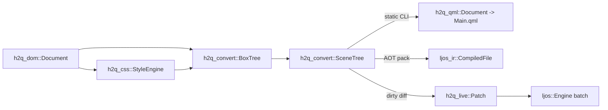

# Design: Live DOM & HTML Renderer Mode for Ljós (`HtmlView`)

Status: Proposed · Branch: `w/live-design`

This document specifies how `html-2-qml` adds a **live, mutable HTML renderer** inside **Ljós** (`~/dev/ljos-ui`) while keeping static QML code generation on the exact same layout and mapping rules (**one pipeline, two back ends**). All existing `src/lib.rs` contracts remain strictly add-only.

---

## 1. One Pipeline, Two Back Ends

### 1.1 Decision: Never Go Through QML Text in Live Mode

The live back end **must not** emit QML text and re-parse it in Ljós:

1. **No parser in shipped Ljós apps.** Ljós forbids runtime crates from depending on `qml_syntax`, `qml_front`, or `ljos_compiler` (`~/dev/ljos-ui/AGENTS.md` Rule 5; `~/dev/ljos-ui/docs/ARCHITECTURE.md` §4 line 246), saving ~106 compiler crates. Runtime text compilation (`set_qml_text_compiler`, `~/dev/ljos-ui/crates/ljos_engine/src/incubator/dynamic.rs:183`) is only installed under `dev-qml` and errors in shipped apps (`ARCHITECTURE.md` §6.3 line 441).
2. **`ljos_ir::CompiledFile` is programmatically constructible.** Every struct and field in `~/dev/ljos-ui/crates/ljos_ir/src/lib.rs` (`CompiledFile`, `ComponentDef`, `ObjectDef`, `TypeRef::Native`, `Members`, `Assignment`, `Literal`, `PropertyBinding`, `Group`, `Attached`, `Binding`, `Tier1`, `JsModule`) is `pub`, owned, and parser-free (`serde` + `postcard` + `blake3`). `CompiledFile::note_facts(&mut self)` (`ljos_ir/src/lib.rs:135`) and `ComponentSignature::of` (`ljos_ir/src/lib.rs:279`) exist explicitly for non-compiler IR producers.
3. **Why `ljos_ir` + direct `Engine` patching work in tandem.** Instantiating a `CompiledFile` through `MapSource` (`~/dev/ljos-ui/crates/ljos_engine/src/loader.rs:294`) and `Engine::create_from_url_in` (`incubator.rs:403`) links a **Component plan** (`~/dev/ljos-ui/CONTEXT.md:7–15`; `ARCHITECTURE.md` §6.3 line 443), evaluates bindings in the **Tier-1 register VM** (`ljos_ir::Tier1`, `ARCHITECTURE.md` §5.4), and supports 3 ms/frame time-sliced incubation (`ARCHITECTURE.md` §6.3 line 440). However, `ljos_ir::ReloadPatch` (`ljos_ir/src/reload.rs:15`) **cannot** be used for DOM mutations: Ljós's `Engine::reload` (`incubator/reload.rs:698`; `ARCHITECTURE.md` §12.1 line 1047) rebuilds the entire component root rather than applying `ReloadOp`s in place.

**Decision:**
- **`h2q_convert`** lowers `BoxTree` to a back-end-neutral, provenance-tagged **`SceneTree`**.
- **Static QML back end** (`h2q_convert::lower_qml`): `SceneTree` → `h2q_qml::Document` → `.qml` text.
- **Static/initial Ljós IR back end** (`h2q_ljos::lower_ir`): `SceneTree` → `ljos_ir::CompiledFile` (for parser-free `.pack` bundles and cold loads).
- **Live incremental Ljós back end** (`h2q_live` + `h2q_ljos::PatchApplier`): diffs `SceneTree` subtrees into `Vec<Patch>` and applies them in place on `ljos::Engine` inside `Engine::batch` (`~/dev/ljos-ui/crates/ljos_engine/src/engine.rs:3094`). Cold load in `HtmlView` can run through `PatchApplier` immediately (diff from empty tree, giving an exact `LiveObjectKey → ObjectId` map today) and switch cold loads to `CompiledFile` once Ljós exposes the 15-line `ObjIdx → ObjectId` creation slice (§4.5).



### 1.2 Back-End-Neutral `SceneTree` in `h2q_convert`

`h2q_qml::Document` cannot serve as the neutral tree because it flattens grouped/attached properties to dotted strings (`"Layout.fillWidth"`), erases `NodeId` provenance, and stringifies bindings into raw JS (`Value::Expr("parent.width * 0.5")`), which `ljos_ir` would have to parse back. Instead, `h2q_convert` adds a `scene` module (keeping `convert` and `convert_str` untouched):

```rust
// Additions to crates/h2q_convert/src/lib.rs (re-exported from mod scene / mod boxes)

/// Which DOM nodes require dedicated QML items (not merged into StyledText).
/// Populated from `h2q_js::Analysis` in static mode, or listener/focus tables in live mode.
pub trait InteractiveSet {
    fn needs_own_item(&self, node: h2q_dom::NodeId) -> bool;
}

/// Stable identity of one generated QML object derived from a DOM node.
#[derive(Debug, Clone, Copy, PartialEq, Eq, PartialOrd, Ord, Hash)]
pub struct LiveObjectKey {
    pub node: h2q_dom::NodeId,
    pub role: ObjectRole,
}

#[derive(Debug, Clone, Copy, PartialEq, Eq, PartialOrd, Ord, Hash)]
pub enum ObjectRole {
    Root,
    Flickable,
    ScrollBar,
    Wrapper,                // Rectangle/Item for background, border, padding, clip, abs CB
    Layout,                 // ColumnLayout, RowLayout, GridLayout, Flow
    InlineRun(u16),         // Text (StyledText) for the nth inline run of `node`
    Control,                // Button, TextField, CheckBox, ComboBox, Slider, ...
    Replaced,               // Image, Canvas
    Marker,                 // List item ::marker Text/Rectangle
    Before,                 // ::before box
    After,                  // ::after box
    HoverSensor,            // HoverHandler for :hover StateVariant
    TapSensor,              // TapHandler for :active / click
    Spacer(u16),            // Flex justify-content spacer Item
}

#[derive(Debug, Clone, Copy, PartialEq, Eq, Hash)]
pub struct QmlTypeRef {
    pub module: &'static str, // "QtQuick", "QtQuick.Layouts", "QtQuick.Controls.Basic"
    pub name: &'static str,   // "Rectangle", "ColumnLayout", "Text", "Button", ...
}

#[derive(Debug, Clone, PartialEq, Eq, Hash)]
pub enum PropTarget {
    Own(&'static str),
    Group { group: &'static str, prop: &'static str },
    Attached { ty: QmlTypeRef, prop: &'static str },
}

#[derive(Debug, Clone, PartialEq)]
pub enum LiteralValue {
    Bool(bool),
    Number(f64),
    String(String),
    Color(h2q_qml::Color),
    Enum { ty: QmlTypeRef, scope: Option<&'static str>, key: &'static str, value: Option<i64> },
    List(Vec<LiteralValue>),
}

/// Closed algebraic set of bindings the CSS -> QML mapping emits.
/// Prints to QML JS text AND compiles directly to `ljos_ir::Tier1` or Rust `Engine::bind` closures.
#[derive(Debug, Clone, PartialEq)]
pub enum BindingExpr {
    Literal(LiteralValue),
    PropRead { target: LiveObjectKey, prop: PropTarget },
    /// `target.<width|height> * factor + offset` (% sizes, calc(% + px), vw/vh against viewport root).
    LinearSize { target: LiveObjectKey, axis: Axis, factor: f64, offset: f64 },
    /// `content.implicitWidth + pad` (wrapper implicit sizing).
    ImplicitPlus { content: LiveObjectKey, axis: Axis, pad: f64 },
    /// State variant conditional (`hover.hovered ? "#0056b3" : "#007bff"`).
    Select {
        cond_target: LiveObjectKey,
        cond_prop: &'static str,
        invert: bool,
        then_expr: Box<BindingExpr>,
        else_expr: Box<BindingExpr>,
    },
}

#[derive(Debug, Clone, PartialEq)]
pub struct SceneObject {
    pub key: LiveObjectKey,
    pub ty: QmlTypeRef,
    pub qml_id: Option<String>,
    pub comment: Option<String>,
    pub literals: Vec<(PropTarget, LiteralValue)>,
    pub bindings: Vec<(PropTarget, BindingExpr)>,
    pub inline_objects: Vec<(PropTarget, Box<SceneObject>)>, // e.g. transform: Translate, background: Rectangle
    pub behaviors: Vec<(PropTarget, Box<SceneObject>)>,
    pub children: Vec<SceneNodeId>,
}
```

Because `BindingExpr` is closed and typed, lowering it to `h2q_qml::Value::Expr` is ~30 lines of formatting, lowering it to `ljos_ir::Tier1` + `JsModule` requires zero JS parsing, and lowering it to `Engine::bind` / `Engine::bind_computed` (`engine.rs:2541,2610`) builds a direct tracked `Engine::read_number` closure (`engine.rs:1385`) with zero QuickJS traffic.

---

## 2. Mutable DOM (`h2q_dom` Additions)

### 2.1 Stable `NodeId`s, Side-Table Liveness, and Quarantined Free List

`h2q_dom`'s public contract (`crates/h2q_dom/src/lib.rs`) exposes `pub struct NodeId(u32)` with `id.index() -> usize`, and `pub enum NodeData` (non-`#[non_exhaustive]`). Furthermore, `h2q_css::StyleMap` indexes `Vec<Option<ElementStyle>>` directly by `id.index()` (`crates/h2q_css/src/lib.rs:189,200`).

To preserve every contract invariant while bounding memory under sustained `innerHTML` churn:
1. **`NodeData` is unchanged.** Adding a `Tombstone` variant would break exhaustive `match`es in downstream crates. Instead, `Document` tracks slot state in private side vectors `generations: Vec<u32>` and `alive: Vec<bool>`.
2. **Detached vs reclaimed.** Per WHATWG DOM, `remove_child` **detaches** a node (`parent = None`, `alive = true`) so JS can re-insert it later. A slot is tombstoned (`alive = false`, `generations[i] += 1`, `children` cleared, `data` replaced with empty `NodeData::Comment(String::new())` to free heap strings while keeping `doc.node(id)` panic-free) only when `destroy_detached(id)` is called for an unreferenced detached subtree (e.g. replaced `innerHTML` children with no live JS wrapper).
3. **`DomHandle` prevents ABA aliasing.** JS/QML wrappers store `DomHandle { id: NodeId, generation: u32 }`; `doc.resolve(handle)` returns `None` once the slot is reclaimed.
4. **Quarantined free list.** Reclaimed `NodeId`s push onto `pending_free: Vec<NodeId>` and move to `free_list: Vec<NodeId>` only inside `take_mutations()`. Thus **no `NodeId` is ever destroyed and re-allocated within the same mutation batch**, eliminating ordering hazards in `MutationRecord` consumers. `doc.len()` remains the slab high-water mark (`nodes.len()`), keeping `id.index() < doc.len()` true for `Vec` side tables; `doc.live_len()` reports live node count.

### 2.2 Mutation API & Change Log Signatures

```rust
// Additions to crates/h2q_dom/src/lib.rs

/// Generation-checked handle for external callers (JS/QML wrappers).
#[derive(Debug, Clone, Copy, PartialEq, Eq, Hash)]
pub struct DomHandle {
    pub id: NodeId,
    pub generation: u32,
}

#[derive(Debug, Clone, PartialEq, Eq, thiserror::Error)]
pub enum DomError {
    #[error("stale or destroyed node {0}")]
    StaleNode(NodeId),
    #[error("hierarchy request error: cannot insert {child} under {parent}")]
    HierarchyRequest { parent: NodeId, child: NodeId },
    #[error("reference node {reference} is not a child of {parent}")]
    NotFound { parent: NodeId, reference: NodeId },
    #[error("operation requires an element or text node, found incompatible kind at {0}")]
    InvalidNodeType(NodeId),
}

#[derive(Debug, Clone, PartialEq, Eq)]
pub enum MutationRecord {
    ChildList {
        parent: NodeId,
        added: Vec<NodeId>,
        removed: Vec<NodeId>,
        /// Immediate neighbours at the splice site (for `+`, `~`, `:nth-child`, `:empty`).
        prev_sibling: Option<NodeId>,
        next_sibling: Option<NodeId>,
    },
    Attribute {
        node: NodeId,
        name: QualName,
        old_value: Option<String>,
        new_value: Option<String>,
    },
    CharacterData {
        node: NodeId,
        parent: Option<NodeId>,
    },
}

impl Document {
    #[must_use] pub fn is_alive(&self, id: NodeId) -> bool;
    #[must_use] pub fn live_len(&self) -> usize;
    #[must_use] pub fn handle(&self, id: NodeId) -> Option<DomHandle>;
    #[must_use] pub fn resolve(&self, handle: DomHandle) -> Option<NodeId>;

    // Creation (parent = None; records no mutation until attached)
    pub fn create_element(&mut self, name: QualName) -> NodeId;
    pub fn create_html_element(&mut self, local: &str) -> NodeId;
    pub fn create_text(&mut self, data: impl Into<String>) -> NodeId;
    pub fn create_comment(&mut self, data: impl Into<String>) -> NodeId;
    pub fn create_fragment(&mut self) -> NodeId;

    // Tree mutations (validate cycles/parent kinds; splice Fragment children per WHATWG DOM)
    pub fn append_child(&mut self, parent: NodeId, child: NodeId) -> Result<NodeId, DomError>;
    pub fn insert_before(
        &mut self,
        parent: NodeId,
        child: NodeId,
        reference: Option<NodeId>,
    ) -> Result<NodeId, DomError>;
    pub fn remove_child(&mut self, parent: NodeId, child: NodeId) -> Result<NodeId, DomError>;
    pub fn remove(&mut self, node: NodeId) -> Result<(), DomError>;
    pub fn replace_child(&mut self, parent: NodeId, new_child: NodeId, old_child: NodeId) -> Result<NodeId, DomError>;
    pub fn clone_node(&mut self, node: NodeId, deep: bool) -> Result<NodeId, DomError>;

    // Attributes & text
    pub fn set_attribute(&mut self, node: NodeId, name: QualName, value: impl Into<String>) -> Result<(), DomError>;
    pub fn set_html_attribute(&mut self, node: NodeId, local: &str, value: impl Into<String>) -> Result<(), DomError>;
    pub fn remove_attribute(&mut self, node: NodeId, local: &str) -> Result<bool, DomError>;
    pub fn set_text(&mut self, text_node: NodeId, data: impl Into<String>) -> Result<(), DomError>;
    pub fn set_text_content(&mut self, node: NodeId, text: &str) -> Result<(), DomError>;

    /// Parses `html` using html5ever's contextual fragment algorithm with `target`'s tag
    /// as context element (so `<tr>` inside `<tbody>` or `<svg>` children parse per spec),
    /// detaches `target`'s existing children, and attaches the parsed fragment nodes.
    pub fn set_inner_html(&mut self, target: NodeId, html: &str) -> Result<Vec<NodeId>, DomError>;
    #[must_use] pub fn serialize_inner_html(&self, target: NodeId) -> String;

    /// Reclaims a detached subtree that has no external `DomHandle` wrappers.
    pub fn destroy_detached(&mut self, root: NodeId, is_pinned: impl Fn(NodeId) -> bool);

    /// Drains queued mutation records and promotes `pending_free` slots into `free_list`.
    pub fn has_mutations(&self) -> bool;
    pub fn take_mutations(&mut self) -> Vec<MutationRecord>;
}
```

---

## 3. Incremental Pipeline

### 3.1 Selector Dependency Index & Style Invalidation

`h2q_css::StyleEngine` pre-indexes every rule in the UA and author `Stylesheet`s into dependency maps keyed by class, id, attribute local name, tag, positional flags, and `:has()` anchors. For each key, bitflags record **where** it appears in a selector:

`DepScope = SELF | DESCENDANTS | NEXT_SIBLING (+) | LATER_SIBLINGS (~) | HAS_INNER`

| Mutation | Style Invalidation | Box / Property Impact |
|---|---|---|
| `Attribute("style")` | `node` only (plus `attr_deps["style"]` if any). | Cascade `node`; recurse to children *only* if an inherited property changed. |
| `Attribute("class")` | Compute `old_classes △ new_classes`. For each changed class `c`, apply `class_deps[c]`: `None` → **0 nodes**; `SELF` → `node`; `DESCENDANTS` → `node` subtree; `NEXT_SIBLING` → `next_element_sibling`; `LATER_SIBLINGS` → `next_siblings`; `HAS_INNER` → matching `:has()` ancestors/siblings. | Usually `PropertiesOnly` or `StateVariant` update unless box-defining properties changed. |
| `Attribute("id")` | Apply `id_deps[old]` and `id_deps[new]`. | Same as `class`, plus updates `#id` fragment scroll target. |
| `Attribute(other)` | Apply `attr_deps[other]`. Intrinsic attrs (`hidden`, `disabled`, `checked`, `src`, `href`, `value`, `placeholder`, `colspan`, `rowspan`, `type`) also mark `node` dirty for UA/`:checked`/`:disabled` or element-attribute mapping. | `src`/`value`/`placeholder` → `Patch::SetProperty` only; `type` on `<input>` → `BoxStructure`. |
| `ChildList` | If added/removed subtree contains `<style>` or `<link rel=stylesheet>`, reload sheets. Mark `added` subtrees `NeedsInitialStyle`. At splice `(prev_sibling, next_sibling)`: dirty `next_element_sibling` if `+` or `:first-child` (at head); dirty later siblings if `~` or `:nth-child`; dirty earlier/all children of `parent` if `:last-child`/`:nth-last-child`/`:only-child`; dirty `parent` if `:empty` flipped; walk ancestors if `uses_has`. | Builds boxes for `added`, destroys boxes for `removed`, updates parent container (`Reparent` + adjacent collapsed margins). |
| `CharacterData` | If `parent` is `<style>`, re-parse sheet. If `parent` matches `:empty` and emptiness flipped, dirty `parent`. Otherwise **0 style work**. | Re-emits parent block's IFC `Text` (`Patch::SetProperty`) or updates `<title>`. |

**Inheritance early-out:** When restyling an existing element `node`, `StyleEngine` compares `old_style` vs `new_style`. If equal, traversal stops. If different, it checks `old_style.inherited_eq(&new_style)` (font, color, line-height, text-align, letter-spacing, white-space, visibility, list-style, custom properties `--*`); when true, clean children are **not** visited unless `node` was marked `DESCENDANTS`.

### 3.2 `h2q_css` Contract Additions

```rust
// Additions to crates/h2q_css/src/lib.rs

#[derive(Debug, Clone, Copy, PartialEq, Eq)]
pub enum StyleDiffKind {
    /// Box-defining style changed: `display` (including `none` <-> rendered), `position`
    /// class (`static/relative` <-> `absolute` <-> `fixed`), `flex-direction`/`flex-wrap`/`order`,
    /// `white-space`, `list-style-type` (`none` <-> marker), or `::before`/`::after` presence.
    BoxStructure,
    /// Box kind is unchanged; only painted, sizing, margin, or state-variant values changed.
    PropertiesOnly,
}

#[derive(Debug, Clone, Default)]
pub struct RestyleReport {
    pub changed: Vec<(NodeId, StyleDiffKind)>,
    pub variants_changed: Vec<NodeId>,
    pub stylesheets_reloaded: bool,
    pub diagnostics: Vec<Diagnostic>,
}

#[derive(Debug, Clone, PartialEq, Eq, thiserror::Error)]
#[error("invalid CSS selector `{selector}`: {message}")]
pub struct SelectorError {
    pub selector: String,
    pub message: String,
}

pub struct StyleEngine { /* sheets, viewport, StyleIndex */ }

impl StyleEngine {
    #[must_use] pub fn new(sheets: Vec<Stylesheet>, viewport: Viewport) -> Self;
    pub fn set_stylesheets(&mut self, sheets: Vec<Stylesheet>);
    #[must_use] pub fn compute_initial(&mut self, doc: &Document) -> StyleMap;

    /// Evaluates media-query breakpoint crossings on resize / theme change; skips cascade
    /// entirely when no `@media` condition flipped (`vw`/`vh` are live QML bindings).
    pub fn update_viewport(&mut self, doc: &Document, styles: &mut StyleMap, vp: Viewport) -> RestyleReport;

    pub fn restyle(
        &mut self,
        doc: &Document,
        styles: &mut StyleMap,
        mutations: &[h2q_dom::MutationRecord],
    ) -> RestyleReport;

    // Reuses h2q_css's swc_css_parser selector AST + matcher for runtime DOM APIs:
    pub fn query_selector(&self, doc: &Document, scope: NodeId, sel: &str) -> Result<Option<NodeId>, SelectorError>;
    pub fn query_selector_all(&self, doc: &Document, scope: NodeId, sel: &str) -> Result<Vec<NodeId>, SelectorError>;
    pub fn matches_selector(&self, doc: &Document, node: NodeId, sel: &str) -> Result<bool, SelectorError>;
}
```

### 3.3 `Patch` Stream & Patching vs Wholesale Subtree Rebuild

```rust
// crates/h2q_live/src/patch.rs

#[derive(Debug, Clone, PartialEq)]
pub enum Patch {
    CreateObject { key: LiveObjectKey, ty: QmlTypeRef, parent: Option<LiveObjectKey>, before: Option<LiveObjectKey> },
    DestroyObject { key: LiveObjectKey },
    Reparent { key: LiveObjectKey, parent: LiveObjectKey, before: Option<LiveObjectKey> },
    SetProperty { key: LiveObjectKey, target: PropTarget, value: LiteralValue },
    ResetProperty { key: LiveObjectKey, target: PropTarget },
    BindProperty { key: LiveObjectKey, target: PropTarget, expr: BindingExpr },
    SetInlineObject { key: LiveObjectKey, target: PropTarget, object: Option<SceneObject> },
    SetHandler { key: LiveObjectKey, signal: &'static str, handler: Option<LiveHandler> },
}
```

**What is patched in place vs rebuilt at a formatting-context boundary:**
- **Inline Formatting Context (IFC):** Editing text or inline tags (`<b>`, `<em>`, `<a href>`, `<span style="color:…">`) re-formats that block's inline run and emits **one `Patch::SetProperty`** (`text`) on `(block_id, InlineRun(k))`. If an inline child gains box decoration (`background`, `border`, `padding`), `:hover`, or a direct DOM listener (`InteractiveSet`), that inline run splits into a `Flow` of child items (`docs/ARCHITECTURE.md` lines 96–99).
- **Wrapper promotion (`PropertiesOnly` vs wrapper threshold):** In static mode, bare layouts omit a `Rectangle` wrapper (`docs/ARCHITECTURE.md` lines 84–90). In live mode, if a `PropertiesOnly` edit crosses `needs_wrapper(old) != needs_wrapper(new)` (e.g. `.active` adds `background-color`), `h2q_live` promotes the box to `(node, Wrapper)` + `(node, Layout)` and marks `node` sticky-wrapped so toggling `.active` off/on thereafter only emits `Patch::SetProperty { color: Transparent / ... }`.
- **Block & Flex child list edits:** `appendChild`/`insertBefore`/`removeChild` builds or destroys only the affected child's `SceneObject`s, places them via `before` (`Engine::set_visual_parent_before`, `engine.rs:1151`), and patches collapsed `Layout.topMargin`/`bottomMargin` on at most the two adjacent in-flow block siblings.
- **Tables, CSS Grid, and `<select>`:** Row/column auto-placement and `colspan`/`rowspan` couple cells within one `<table>` or `display: grid` container. Structural child edits inside a table/grid re-run track/cell placement for that container whole, updating `Layout.row`/`column`/`rowSpan`/`columnSpan` on surviving cell `LiveObjectKey`s without destroying cell subtrees. Mutating `<option>` children under `<select>` re-emits `SetProperty` on the `ComboBox`'s `model`.

---

## 4. The `document` in Ljós

### 4.1 Native Rust Binding Mechanism in Ljós

Ljós exposes Rust types to **both QML expressions and `rquickjs` scripts** through `#[derive(QmlObject)]` and `#[qml_impl]`, registered via `Engine::register_module(ljos::module!(...))` (`~/dev/ljos-ui/crates/ljos/src/lib.rs:19–55`; `~/dev/ljos-ui/crates/ljos_macros/src/lib.rs:8–119`).
- Returning `ObjectId` or `Option<ObjectId>` (`QmlValue` impl in `~/dev/ljos-ui/crates/ljos_engine/src/types.rs:785`) hands JS a cached `Persistent<Object>` wrapper (`JsHost::wrapper`, `~/dev/ljos-ui/crates/ljos_js/src/host.rs:898`; `ARCHITECTURE.md` §9.2 lines 839–841) with prototype `Accessor` getters/setters (~53 ns per call, `ARCHITECTURE.md` §3.2 line 98). Destroyed `ObjectId`s read as `null` via `SlotMap` generational keys (`ARCHITECTURE.md` §6.1 line 358).
- Method parameters of type `ljos::prelude::Value` (`TypeTag::Var`, `types.rs:755`) keep JS callback functions intact on the QuickJS heap (`Value::Js(JsHandle)`), invoked from Rust via `Engine::try_call_value(this, &cb, &args)` (`qtqml.rs:1415`).
- Returning `Vec<ObjectId>` (`types.rs:812`) yields a JS Array of element wrappers, so `querySelectorAll` and `el.children` support `[i]`, `.length`, `for..of`, and `.map()` in both QML and page JS without custom exotic collection proxies.

### 4.2 DOM Wrapper Object Model (`H2Q` Module)

Wrappers are **`#[qml(uncreatable)]` native QML objects created lazily on demand** (`Engine::create_native`, `engine.rs:597`) and cached in `LiveDocState::wrappers: HashMap<DomHandle, ObjectId>` owned by `HtmlView`. Thus:
1. A 5,000-node page allocates **zero** `ObjectId` wrappers for untouched DOM nodes.
2. `view.document.getElementById("a") === view.document.querySelector("#a")` holds across QML and page JS.
3. **Re-entrancy safety** (`ARCHITECTURE.md` §6.1 line 368): no `RefCell<LiveDocState>` borrow is ever held across `Engine::try_call_value`, `Engine::emit`, or `Engine::batch`.

| Native QML Type | Key Properties (`#[qml(notify, write = ...)]`) & `#[qml(invokable)]` Methods |
|---|---|
| `HtmlDocument` | Props: `title`, `body`, `documentElement`, `activeElement`, `readyState`, `revision`. Methods: `getElementById`, `querySelector`, `querySelectorAll`, `getElementsByClassName`, `getElementsByTagName`, `createElement`, `createTextNode`, `createComment`, `createDocumentFragment`, `addEventListener`, `removeEventListener`, `dispatchEvent`. |
| `DomElement` (covers `Node` + `Element`) | Props: `nodeType`, `nodeName`, `tagName`, `id`, `className`, `textContent`, `innerHTML`, `value`, `checked`, `disabled`, `hidden`, `parentNode`, `parentElement`, `firstChild`, `lastChild`, `previousSibling`, `nextSibling`, `previousElementSibling`, `nextElementSibling`, `children`, `childNodes`, `style` (lazy `DomStyle`), `classList` (lazy `DomTokenList`), `dataset` (lazy `PropertyMap`), `qmlItem` (`Option<ObjectId>`). Methods: `appendChild`, `insertBefore`, `removeChild`, `replaceChild`, `remove`, `cloneNode`, `getAttribute`, `setAttribute`, `removeAttribute`, `hasAttribute`, `matches`, `closest`, `querySelector`, `querySelectorAll`, `addEventListener`, `removeEventListener`, `dispatchEvent`, `focus`, `blur`, `getBoundingClientRect`. |
| `DomStyle` | Typed camelCase properties (`color`, `backgroundColor`, `width`, `height`, `display`, `opacity`, `visibility`, `fontSize`, `fontWeight`, `margin*`, `padding*`, `border*`, `flex*`, `gap`, `zIndex`, `transform`, `cssText`) + `setProperty(name, val)`, `getPropertyValue(name)`, `removeProperty(name)` mutating the element's `style` attribute. |
| `DomTokenList` | `length`, `value`, `add(tokens)`, `remove(tokens)`, `toggle(token, force)`, `contains(token)`, `replace(old, new)`. |

**Coalesced mutation flush:** DOM mutations update `h2q_dom::Document` synchronously (so immediate JS reads of `children`, `textContent`, `querySelector`, or `getAttribute` see the new DOM at once) and arm at most one micro-turn flush (`dirty_scheduled: bool`). The flush (`take_mutations` → `StyleEngine::restyle` → `h2q_live::diff` → `engine.batch(|| apply_patches)`) runs at the end of the current JS callback/setter turn — or immediately on demand when JS reads layout geometry (`getBoundingClientRect`, `offsetWidth`, computed via `ljos::item::scene_rect`, `~/dev/ljos-ui/crates/ljos/src/item.rs:160`).

### 4.3 Per-`HtmlView` Page Script Scope

Ljós runs **one QuickJS `Runtime` and `Context` per `Engine`** (`ARCHITECTURE.md` §3.2 line 98), and `Engine::eval_js` evaluates in the global scope (`~/dev/ljos-ui/crates/ljos_engine/src/js.rs:1460`). Installing `window`/`document` on `globalThis` would break multiple `HtmlView` instances in one app.

Instead, `h2q_live` creates a per-instance `HtmlWindow` `QmlObject` (`document`, `innerWidth`, `innerHeight`, `scrollX`, `scrollY`, `devicePixelRatio`, `location`, `navigator`, `console`, `localStorage`, `sessionStorage`, `setTimeout`, `clearTimeout`, `setInterval`, `clearInterval`, `requestAnimationFrame`, `cancelAnimationFrame`, `fetch`, `matchMedia`, `getComputedStyle`). Classic `<script>` blocks and inline `on*` attributes are parsed with `oxc` (zero DOM rewriting — only hoisting top-level `var`/`function` bindings onto `window` so multi-`<script>` globals share state) and compiled as a function `(window, document, self, globalThis, ...globals) => { ... }` invoked via `Engine::try_call_value(window_id, &fn_val, &args)`.

### 4.4 Events, Timers, `UiHandle`, and 0 % Idle CPU

- **3-phase DOM events:** QML signals connected via `Engine::connect_to` (`~/dev/ljos-ui/crates/ljos_engine/src/signal.rs:201`) on controls/sensors (`Button.clicked`, `TapHandler.tapped`, `HoverHandler.hoveredChanged`, `WheelHandler.wheel`, `Keys.pressed`/`released`, `TextField.textEdited`/`editingFinished`, `CheckBox.toggled`, `ComboBox.activated`, `Text.linkActivated`, `Item.activeFocusChanged`) map to a target `NodeId`. For delegated pointer listeners on `document`/`body`/ancestors, a non-grabbing `TapHandler`/`HoverHandler` on the content root hit-tests the deepest rendered `NodeId` via `ljos::item::contains_point` (`item.rs:109`) without stealing presses from Controls or `Flickable`. `h2q_live` snapshots the ancestor path `[NodeId(0), ..., target]` in `h2q_dom` and runs **Capture → Target → Bubble** phases, honouring `stopPropagation()`, `stopImmediatePropagation()`, `{ capture, once, passive }`, and `preventDefault()` (setting `KeyEvent.accepted = true` or suppressing `linkActivated` / form submit).
- **Timers (`0 % CPU when idle`):** `setTimeout`/`setInterval` use `Engine::call_at` and `Engine::cancel_call` (`qtqml.rs:1033,1045`) on Ljós's injectable `Clock` (`ARCHITECTURE.md` §2 principle 8). `requestAnimationFrame` toggles a single lazy `FrameAnimation` child (`running: !raf_queue.is_empty()`), stopping immediately once the queue drains. `HtmlView` destruction cancels all tracked `TimerId`s. At rest, **zero** timers, animations, or pollers are armed (`ljos-ui/AGENTS.md` Rule 6).
- **Bounded off-thread I/O (`UiHandle`):** Sub-resources (`<link rel=stylesheet>`, `<script src>`, `fetch()`, remote `HtmlView.source`) use `ljos::prelude::Platform::fetch` (`~/dev/ljos-ui/crates/ljos/src/lib.rs:61–69`), and `asynchronous: true` HTML/CSS parsing uses `ljos::task::spawn_for` (`~/dev/ljos-ui/crates/ljos/src/task.rs:206`), both delivering results strictly over Ljós's bounded `UiHandle` inbox (`ljos-ui/AGENTS.md` Rule 7; `ARCHITECTURE.md` §3.3 lines 108–115). Images use Ljós's `Image { asynchronous: true }` cache.

### 4.5 Repository Boundary & Proposed General-Purpose Ljós Additions

Per `ljos-ui/AGENTS.md` Rule 2 (`ARCHITECTURE.md` §2 Principle 9), **nothing HTML, CSS, or DOM-specific enters `ljos-ui`**. All DOM/CSS/HTML types live in `html-2-qml` (`h2q_live`, `h2q_ljos`). Where Ljós currently lacks a generic primitive, we propose three small, general-purpose additions to `ljos-ui`:

1. **`PropertyMap` dynamic missing-key hook** (`~/dev/ljos-ui/crates/ljos_engine/src/property_map.rs:18–24`, already tracked on Ljós's `@backlog` in `features/models/property-map.feature`): intercept reads/writes of keys not pre-inserted at creation, completing `QQmlPropertyMap` parity and enabling `el.dataset.newKey = "x"` from JS. (Fallback until landed: pre-populate `PropertyMap` from parsed `data-*` attributes and sync via `setAttribute`.)
2. **`Engine::compile_function(source_name: &str, params: &[&str], body: &str) -> Result<Value, EngineError>`**: wraps `JsHost` function compilation with `SourceMapper` provenance (`ljos_js/src/host.rs:1749`) so dynamic/plugin scripts report real `file:line` stack traces instead of `<eval>`. (Fallback today: `Engine::eval_js` returning a function expression.)
3. **`Engine::create_from_compiled(file: &Arc<CompiledFile>, parent: Option<ObjectId>) -> Result<(ObjectId, Box<[ObjectId]>), EngineError>`**: returns the `ObjIdx → ObjectId` table the `Incubator` already allocates in Phase 1 (`ARCHITECTURE.md` §6.3 line 431), letting any programmatic `ljos_ir` host bind to created sub-objects in O(1) without walking `visual_children`. (Fallback today: `PatchApplier` cold instantiation.)

---

## 5. `HtmlView` Item

Registered in module `"H2Q" 1.0` (`h2q_ljos::register(&engine)`):

```qml
import QtQuick
import H2Q 1.0

HtmlView {
    id: page
    anchors.fill: parent
    source: "https://example.test/app.html" // or inline `html: "<h1>Hello</h1>"`
    onLoaded: {
        const h1 = page.document.querySelector("h1")
        h1.textContent = "Hello from QML"
    }
    onLinkActivated: (url) => Qt.openUrlExternally(url)
}
```

```rust
#[derive(Default, QmlObject)]
#[qml(module = "H2Q", name = "HtmlView", extends = Item, enums = Self::enums)]
pub struct HtmlView {
    #[qml(base)]                                  pub item: Item,
    #[qml(notify, write = Self::set_source)]      pub source: Url,
    #[qml(notify, write = Self::set_html)]        pub html: Atom,
    #[qml(notify)]                                pub base_url: Url,
    #[qml(readonly, notify, enumeration = "Status")] pub status: i32, // Null=0, Ready=1, Loading=2, Error=3
    #[qml(readonly, notify)]                      pub error_string: Atom,
    #[qml(notify)]                                pub asynchronous: bool,
    #[qml(notify)]                                pub scripts_enabled: bool, // default true
    #[qml(notify)]                                pub scrollable: bool,      // default true
    #[qml(readonly, notify, object = "HtmlDocument")] pub document: Option<ObjectId>,
    #[qml(readonly, notify)]                      pub title: Atom,
    #[qml(readonly, notify)]                      pub canvas_color: Color,
    #[qml(readonly, notify)]                      pub content_width: f64,
    #[qml(readonly, notify)]                      pub content_height: f64,
    #[qml(notify, write = Self::set_content_x)]   pub content_x: f64,
    #[qml(notify, write = Self::set_content_y)]   pub content_y: f64,
    #[qml(readonly, notify)]                      pub diagnostics: Vec<String>,
}

#[qml_impl]
impl HtmlView {
    #[qml(signal)] fn loaded();
    #[qml(signal)] fn load_failed(error: Atom);
    #[qml(signal)] fn link_activated(url: Atom);
    #[qml(signal)] fn console_message(level: Atom, message: Atom, line: i32);

    #[qml(invokable)] fn reload(cx: &Cx) -> Result<(), EngineError>;
    #[qml(invokable)] fn run_script(cx: &Cx, code: Atom) -> Result<Value, EngineError>;
}
```

- **Internal scene structure:** `HtmlView` creates an internal `viewport` child `Item` (`anchors.fill: parent; clip: true`) painted with `canvas_color`, leaving `HtmlView`'s own QML `children` untouched for user overlays (e.g. a `BusyIndicator`). `position: fixed` boxes parent to `viewport` (pinned to `HtmlView`, never escaping to the app's `Window`).
- **Scrolling & sizing:**
  - `scrollable: true` (default): `implicitWidth = 640`, `implicitHeight = 480`. Inside `viewport`, an internal `Flickable` + `ScrollBar.vertical` holds the `<body>` box (`width: flickable.width`, `contentHeight: body.implicitHeight`), two-way synced with `contentX`/`contentY` and `window.scrollY`. Clicking `<a href="#id">` scrolls `contentY` to the target box when not `defaultPrevented`; other links emit `linkActivated(url)`.
  - `scrollable: false`: omits `Flickable`; `HtmlView`'s `implicitWidth`/`implicitHeight` bind via `Engine::bind_computed` (`engine.rs:2610`) to the body box's `implicitWidth`/`implicitHeight`, so HTML cards/snippets flow and wrap height-for-width inside an outer QML `ColumnLayout` or `ListView` delegate.
- **Viewport & system preferences:** `HtmlView` tracks its own `width`/`height`, `ljos::color_scheme(&engine)` (`lib.rs:315`), and `ljos::reduced_motion(&engine)` (`lib.rs:331`). `%` and `vw`/`vh` bindings update natively in Ljós on resize; `StyleEngine::update_viewport` re-runs the CSS cascade only when resize crosses a cached `@media` breakpoint interval or theme/motion preferences change.

---

## 6. Crate Plan, Milestones, Risks & Open Questions

### 6.1 Crate Layout & Dependencies

| Crate | Role | New Dependencies |
|---|---|---|
| `h2q_dom` | Arena DOM + mutations, `DomHandle` generations, `MutationRecord` log | `thiserror` (already in workspace) |
| `h2q_css` | `StyleEngine`, selector dependency index, incremental `restyle`, `query_selector*` | — |
| `h2q_convert` | `BoxTree` + neutral `SceneTree` + `lower_qml` (`h2q_qml::Document`) | — |
| `h2q_live` *(new)* | Engine-agnostic `LiveDocument`, coalesced restyle/box diff → `Vec<Patch>`, 3-phase DOM event routing, `oxc` page-script wrapper | `h2q_dom`, `h2q_css`, `h2q_convert`, `oxc_*`, `indexmap`, `smallvec`, `thiserror` (**no `ljos` dep**) |
| `h2q_ljos` *(new)* | `HtmlView`, `HtmlDocument`, `DomElement`, `PatchApplier`, `SceneTree -> ljos_ir::CompiledFile` | `h2q_live`, `ljos` (`default-features = false`: no egui shell, no ALSA, **no QML parser**), `ljos_ir`; `[dev-dependencies]`: `ljos` (`features = ["testing", "render", "dev-qml"]`) |

Keeping `h2q_live` free of `ljos` lets `h2q_cli` and 90% of incremental invalidation/diff tests build standalone without `ljos-ui`, while gating `h2q_ljos` (or linking `ljos-ui` via git/path) cleanly isolates the runtime integration. All `ljos-ui` crates are permissively licensed (MIT/Apache-2.0).

### 6.2 Milestones & Testable Exit Criteria

1. **M1 — Neutral `SceneTree` & Static `HtmlView` in Ljós.**
   Split `h2q_convert` into `BoxTree → SceneTree → h2q_qml::Document`; implement `h2q_ljos::to_compiled_file` (`ljos_ir::CompiledFile`), `PatchApplier` cold load, and `HtmlView { html }`.
   *Exit:* All existing `tests/corpus/*` snapshots stay byte-identical (`mise run test`, `mise run qml:check`); `h2q_ljos` renders the corpus in `ljos::testing::TestWindow` with a link-check test asserting `qml_syntax`/`qml_front` are absent.
2. **M2 — Mutable `h2q_dom` + Incremental `h2q_css::StyleEngine`.**
   Implement `h2q_dom` mutations, contextual `set_inner_html`, quarantined free list, `MutationRecord`s, and `StyleEngine` (`restyle`, `query_selector*`).
   *Exit:* Randomised mutation-sequence test (class/id/attr/style edits, `+`/`~`/`:nth-child`/`:empty`/`:has`, `innerHTML`) asserts `StyleEngine::restyle` equals a cold `compute_styles(&doc)` on every step, clean subtrees record 0 restyles, and `doc.len()` stays bounded over 10,000 `innerHTML` replacements.
3. **M3 — `h2q_live` Subtree Diffing & Incremental `PatchApplier`.**
   Connect `MutationRecord` → `RestyleReport` → `Vec<Patch>` → `Engine::batch` (`set_visual_parent_before`, IFC `Text` re-emission, sticky wrapper promotion, table/grid cell placement updates).
   *Exit:* Differential rendering test in `ljos::testing::TestWindow`: mutating a live `HtmlView` across 20 scripted DOM scenarios produces the exact same `accessibility_tree()` and rendered PNG (`ljos::render`) as loading the serialized post-mutation HTML fresh.
4. **M4 — Shared `document` in QML & Page JS, 3-Phase Events, and Timers.**
   Ship `HtmlDocument`/`DomElement`/`DomStyle`/`DomTokenList`, per-`HtmlView` scoped `<script>` execution, Capture/Target/Bubble event dispatch, `Engine::call_at` timers, and lazy `FrameAnimation` `requestAnimationFrame`.
   *Exit:* Interactive QML + JS tests (todo list with event delegation, class-toggled tabs, form controls, QML mutating `view.document.querySelector(...)` observed by page JS and vice versa); once settled on the virtual clock, `engine.running_timers()` is empty (0 % idle CPU).
5. **M5 — Async Sub-Resources, Viewport Media Breakpoints & Polish.**
   Wire `Platform::fetch` (`UiHandle`), `ljos::task::spawn_for` (`asynchronous: true`), `@media` breakpoint interval caching + `color_scheme`/`reduced_motion`, `#id` anchor scrolling, and `linkActivated`.
   *Exit:* `TestWindow` + `serve_while_waiting` fake-network suite passes async load, mid-flight cancellation on `HtmlView` teardown, and responsive `@media (max-width: 600px)` resize reflow without redundant cascades.

### 6.3 Risks

- **Re-entrancy across JS ↔ Ljós signals ↔ DOM:** A DOM setter or event listener can synchronously fire a QML handler that mutates `document` again. *Mitigation:* `LiveDocState` borrows are short-lived; listener vectors and `Patch` batches are cloned/drained before calling `Engine::try_call_value` or `Engine::batch`.
- **Pointer hit-testing vs QML Controls:** A root pointer hook that grabs presses would starve child `Button`, `TextField`, and `Flickable` gestures. *Mitigation:* Controls emit via `Engine::connect_to`; delegated pointer hit-testing uses non-grabbing handlers and `ljos::item::contains_point`.
- **Multi-`<script>` classic global semantics:** Pages expecting `var x` in `<script>#1` to appear as `window.x` in `<script>#2` without polluting QuickJS `globalThis` across two `HtmlView`s. *Mitigation:* `oxc` hoists top-level classic declarations onto the per-instance `HtmlWindow` object.

### 6.4 Open Questions for the Owner

1. **Workspace dependency wiring to `ljos-ui`:** Parallel git worktrees (`../html-2-qml-wt/<branch>`) sit at a different relative depth from `~/dev/ljos-ui` than the main checkout (`../../ljos-ui` vs `../ljos-ui`). Should `Cargo.toml` reference `ljos` and `ljos_ir` by git URL (overridden locally via `.cargo/config.toml` `[patch]`), or exclude `crates/h2q_ljos` from default workspace members?
2. **Approve the three general-purpose `ljos-ui` additions (§4.5)?** Specifically: (a) `PropertyMap` missing-key read/write hook (`@backlog`), (b) `Engine::compile_function` with `SourceMapper` file:line traces, and (c) `Engine::create_from_compiled` returning `(ObjectId, Box<[ObjectId]>)`.
3. **`HtmlView.linkActivated` default behaviour:** Should `HtmlView` strictly emit `linkActivated(url)` and leave external opening to the QML author (matching QML `Text`), or also expose `openExternalLinks: bool` (default `false`)?
4. **Sticky live wrapper / IFC-split promotion (§3.3):** When a live mutation promotes a bare layout to a `Rectangle` wrapper (or splits an inline `<span>` out of StyledText into a `Flow`), keeping that promotion sticky for the `NodeId`'s lifetime makes repeated class toggles O(1) property writes at the cost of one retained wrapper `Item`. Is sticky promotion acceptable?
5. **`h2q_dom::NodeData` contract:** Keeping liveness and generations in side vectors on `Document` honours `NodeData`'s exhaustive public contract today. Should `NodeData` remain unchanged permanently, or get `#[non_exhaustive]` in a future coordinated contract update?
