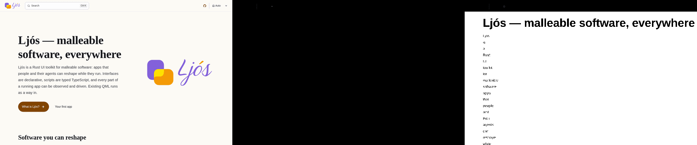
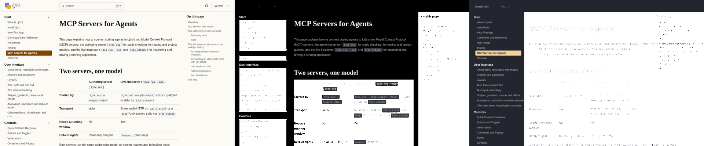
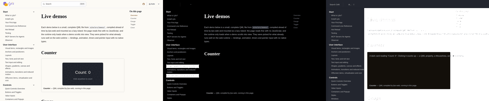

# Trial: ljos.dev

Three pages of a real static site, built with Astro and Starlight, were
converted with Eldur. Each conversion was rendered off-screen with qml6 and
with Ljós, and compared with Chromium. The pages:

- **Landing:** the splash page, with a hero, call-to-action links and a logo.
- **MCP:** a long docs page, with a sidebar, a table of contents, tables and
  inline code.
- **Demos:** a docs page that holds a live island, a counter drawn by a script
  module.

## Method

- **Site:** `site/` of the ljos-web repository (Astro and Starlight), built into
  `site/dist`.
- **Serving:** each page was served over HTTP, as a deployed site is. Its
  root-relative URLs (`/_astro/…`) only resolve that way.
- **Conversion:** each page was converted with `eldur convert` (with
  `--site-root site/dist`, see below), from a build that holds the fixes listed
  under "Fixed".
- **Rendering:**
  - qml6 rendered through `tools/visual/render_qml.py --backend gl` at
    1280×800.
  - Ljós rendered through `ljos render` at the same size.
  - Chromium 158 rendered through Playwright at the same size, with the
    light scheme.
- **Pictures:** each picture puts the three renders side by side at 640 px
  wide. The left one is Chromium, the middle one qml6, the right one Ljós.

| Page | Main.qml lines | page.js lines |
|---|---:|---:|
| Landing | 4 060 | 96 |
| MCP | 33 341 | 134 |
| Demos | 11 108 | 134 |

### Landing

### MCP

### Demos

## Features

**Clean** means it looks and behaves as in Chromium. **Degraded** means it is
there but wrong. **Fails** means it is missing or throws.

### Assets and loading

| Feature | qml6 | Ljós | Cause |
|---|---|---|---|
| Root-relative CSS, scripts and images (`/_astro/x.css`) | Clean with `--site-root`; fails without it | Same as qml6 | #2: they resolved under the file system root. Fixed by #12. |
| `import()` of a lazy chunk (Starlight, Astro islands) | Clean for page modules; a missing one rejects | Same | #3: the whole of page.js was refused at the `import(` token. Fixed by #10. |
| Conversion time | Degraded: the MCP page takes the longest | (n/a) | #9: each `:hover` variant re-runs the cascade. |

### Page structure and text

| Feature | qml6 | Ljós | Cause |
|---|---|---|---|
| Docs layout: header, sidebar, content, table of contents | Clean on MCP and demos | Clean | |
| Sidebar navigation groups | Degraded: some groups paint a white box with light text | Clean | Follows the dark scheme (see "Colour scheme"). |
| Table of contents ("On this page") | Clean | Clean | |
| Tables (MCP) | Clean | Degraded: faint text | Ljós text colour. |
| Inline code, headings, paragraphs (MCP, demos) | Clean | Degraded: the H1 is missing, and the body text is faint | Ljós. |
| Landing hero (H1, text, buttons, logo) | Fails: the page is black | Degraded: the H1 shows; the paragraph wraps one word per line | qml6: #16, then #17 aborts the settle pass. Ljós: its wrap mode. |

### Header and theme

| Feature | qml6 | Ljós | Cause |
|---|---|---|---|
| Header: search, GitHub, theme picker | Degraded: mostly empty | Degraded: dark, labels only | #5 (inline SVG icons), #8 (the picker's `<select>` inside an inline element). |
| Buttons with an icon ("What is Ljós? →") | Degraded | Degraded | #6: only the text shows. |
| Theme picker custom element (`starlight-theme-select`) | Clean after the fix | Clean after the fix | #4: `extends HTMLElement` threw on load. Fixed by #15. |
| Theme provider (`window.StarlightThemeProvider = …`, then a bare name) | Fails: ReferenceError | Fails | #16. Fixed by #19. |
| Colour scheme | Dark: `matchMedia("(prefers-color-scheme: light)")` is false | Dark | The off-screen run has no light preference. Chromium ran with the light scheme. |

### Scripts and the live island

| Feature | qml6 | Ljós | Cause |
|---|---|---|---|
| Script-made lists after a state change | Fails: the settle pass aborts | (n/a) | #17: `_gWatch` hands an inline-model record to `createQmlObject`. |
| `replaceChildren` on an element resolved at conversion time | Degraded: keeps its old text | (n/a) | #18 |
| Demos counter island (a module that draws on a canvas) | Fails: the card is empty | Degraded: a dark card with its alt text | The island needs the web runtime. Out of scope. |

### Tooling

| Feature | Before | After | Cause |
|---|---|---|---|
| `eldur check` sees script errors | Fails | Clean | #7: qml6 did not log to stderr. Fixed by #11. |
| `render_qml.py` on a run that times out | Fails: TypeError | Clean | #13. Fixed by #14. |

## Issues

| Issue | Status | Gap |
|---|---|---|
| #2 | Fixed by #12 | Root-relative URLs resolved under the file system root. |
| #3 | Fixed by #10 | Dynamic `import()` was refused. |
| #4 | Fixed by #15 | Custom elements threw. |
| #7 | Fixed by #11 | `eldur check` did not see script errors. |
| #13 | Fixed by #14 | A render that timed out raised a TypeError. |
| #16 | Fixed by #19 | `window.X` was not a global. |
| #5 | Open | Inline `<svg>` becomes a placeholder. |
| #6 | Open | A `<button>` with element children shows only their text. |
| #8 | Open | An inline element's form control is missing from queries. |
| #9 | Open | Conversion time grows with state rules × elements. |
| #17 | Open | State watches walk into inline-model records. |
| #18 | Open | `replaceChildren` keeps old text. |

## What the next lane can start from

The converted QML is a usable starting point for a hand-written port of these
parts. It is not usable as a finished page.

- **Docs layout** (MCP, demos): the three columns, header, sidebar and table of
  contents are laid out as in Chromium, with sizes and spacing from the
  computed CSS. Start from the outer items of `Main.qml`.
- **Sidebar navigation:** the groups and links are there in order, with the
  current page marked. Take the colours from the light scheme.
- **Tables and code** (MCP): rows, column widths and inline code boxes match.
- **Landing hero layout:** the item tree is right, but it renders only once #16
  and #17 are fixed. The logo needs #5.
- **Search:** only the trigger button converts. The search dialog is a lazy
  module (Pagefind), and needs a native port.
